# Extending Amazon Sumerian Hosts with American Sign Language

23 ASL signs as engine-ready clips for Sumerian-style characters,
worked on Fiona.
[Live demo](https://bryanchasko.com/signing-hosts/?host=fiona&shot=signing) ·
[all 23 clips](https://github.com/bryanchasko/amazon-sumerian-hosts-asl/releases/tag/v0.2-batch5) ·
Apache-2.0 (scripts/docs), CC BY-SA 4.0 (meshes).


## Prerequisites

- Blender 5.2 LTS (free). Everything here runs headless.
- Python 3, for the repo's check scripts.
- A host rig file (below).

```bash
mkdir -p ~/opt && cd ~/opt
curl -sSO https://download.blender.org/release/Blender5.2/blender-5.2.3-linux-x64.tar.xz
tar xf blender-5.2.3-linux-x64.tar.xz
ln -sfn ~/opt/blender-5.2.3-linux-x64/blender ~/.local/bin/blender-5.2
blender-5.2 --version   # Blender 5.2.3 LTS
```

## Try it: Fiona signs THANK-YOU

Render the citation still, then export the 72-frame engine clip:

```bash
blender -b --factory-startup --python-exit-code 1 \
  -P scripts/blender/render_host_shots.py -- \
  --out-dir out --shot signing-torso --rig fiona
# RENDER_OK out/spike-host-signing-torso.png posed=36

blender -b --factory-startup --python-exit-code 1 \
  -P scripts/blender/export_sign_clip.py -- \
  --sign thank-you --rig fiona --out out/sign-thank-you-fiona.glb
# CLIP_OK out/sign-thank-you-fiona.glb action=thank-you
```

`posed=36` (bones posed), `CLIP_OK` (armature-only `thank-you`
action exported). Ready-made exports ship as
[release assets](https://github.com/bryanchasko/amazon-sumerian-hosts-asl/releases)
— `.glb` travels through the asset pipeline, not git.

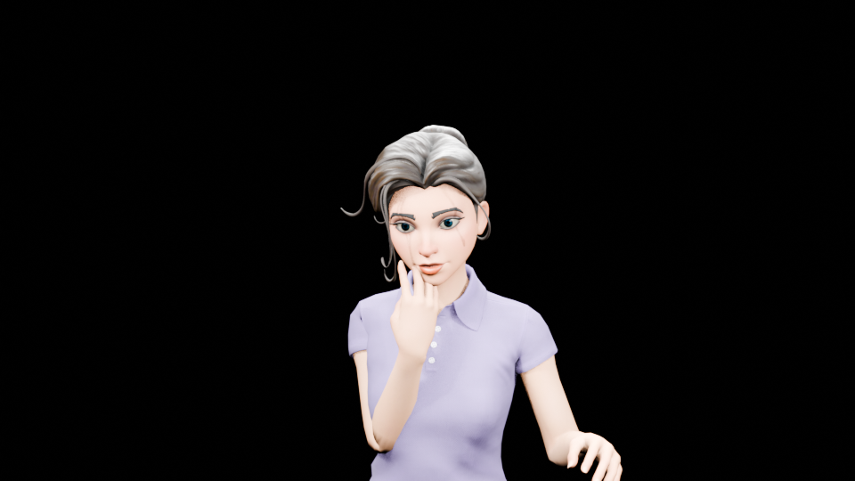
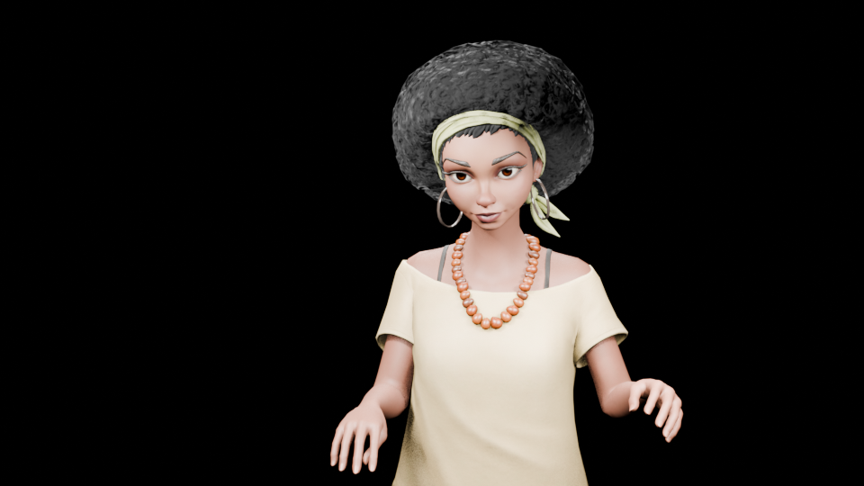

Flat hand at the chin, fingertips at the lips; forward-down arc to
the palm-down end hold (frames 44–52 of 72).

Play it in the Blender UI: open Blender, delete the cube, `File >
Import > glTF 2.0` → `fiona.glb`, then import
`sign-thank-you-fiona.glb` the same way. Open a Dope Sheet, switch
it to Action Editor, select Fiona's armature, pick `thank-you`,
drag to frame 36, press **Spacebar**. Full tour with screenshots:
[Open Fiona in Blender and press
play](#open-fiona-in-blender-and-press-play).

## The 23 signs

All ai-reviewed, all with engine clips. Proposed signs live in
[`data/lexicon/lexicon.v1.json`](data/lexicon/lexicon.v1.json)
without clips yet. Five signs carry the full comparison: real
human reference, Muse Image output with its exact prompt, the
rig still, and a verdict — each judged against the reference
first. Reference photos are hotlinked Lifeprint originals, not
vendored.

| sign      | real world                                                                                                                                                      | Muse Image                                                                                                                                                                                                                                              | Fiona rig                                                        | clip                                                                                                                                        | verdict                                                                 |
| --------- | --------------------------------------------------------------------------------------------------------------------------------------------------------------- | ------------------------------------------------------------------------------------------------------------------------------------------------------------------------------------------------------------------------------------------------------- | ---------------------------------------------------------------- | ------------------------------------------------------------------------------------------------------------------------------------------- | ----------------------------------------------------------------------- |
| HELLO     | [no fixed form — any wave](https://www.lifeprint.com/asl101/pages-signs/h/hello.htm)                                                                            | 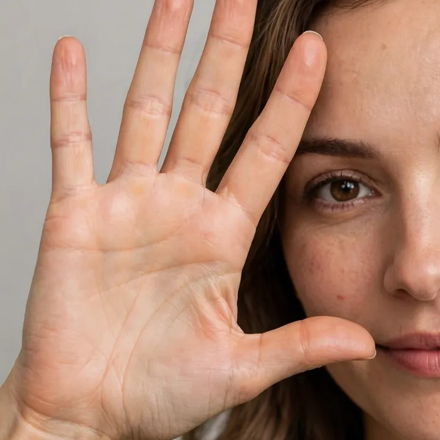<details><summary>prompt</summary>muse-image-1.0 · POST /v1/images/generations<br>photorealistic adult woman signing ASL HELLO, hands clearly visible, neutral background</details>         | 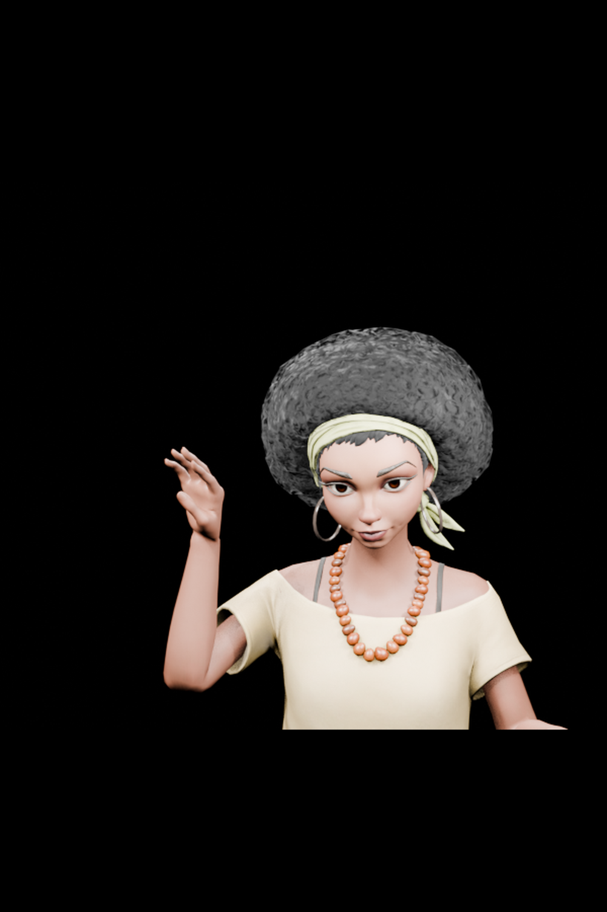     | [sign-hello-fiona.glb](https://github.com/bryanchasko/amazon-sumerian-hosts-asl/releases/download/v0.2-batch5/sign-hello-fiona.glb)         | AI FAIL vs authored B salute (reference allows wave variants); rig PASS |
| THANK-YOU | <a href="https://www.lifeprint.com/asl101/pages-signs/t/thankyou.htm"></a> | <details><summary>prompt</summary>muse-image-1.0 · POST /v1/images/generations<br>photorealistic adult woman signing ASL THANK-YOU, hands clearly visible, neutral background</details> | 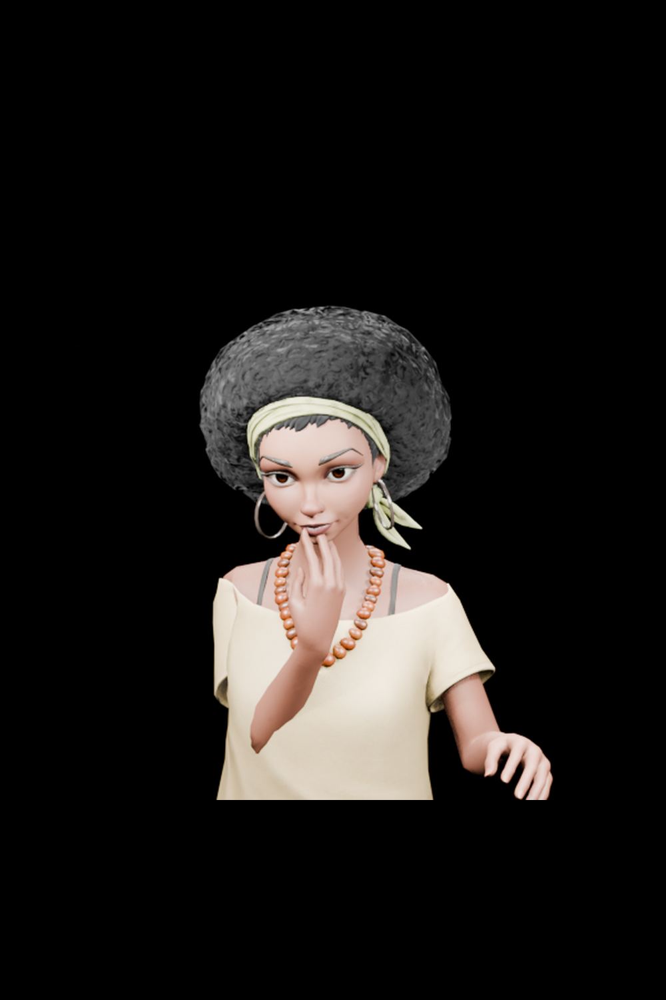 | [sign-thank-you-fiona.glb](https://github.com/bryanchasko/amazon-sumerian-hosts-asl/releases/download/v0.2-batch5/sign-thank-you-fiona.glb) | AI FAIL — palm down, not toward signer; rig PASS                        |
| YES       | <a href="https://www.lifeprint.com/asl101/pages-signs/y/yes.htm"></a>              | 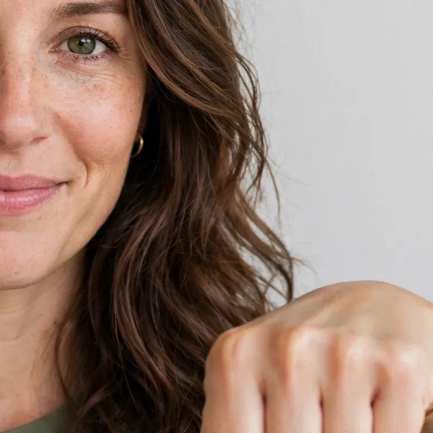<details><summary>prompt</summary>muse-image-1.0 · POST /v1/images/generations<br>photorealistic adult woman signing ASL YES, hands clearly visible, neutral background</details>             | 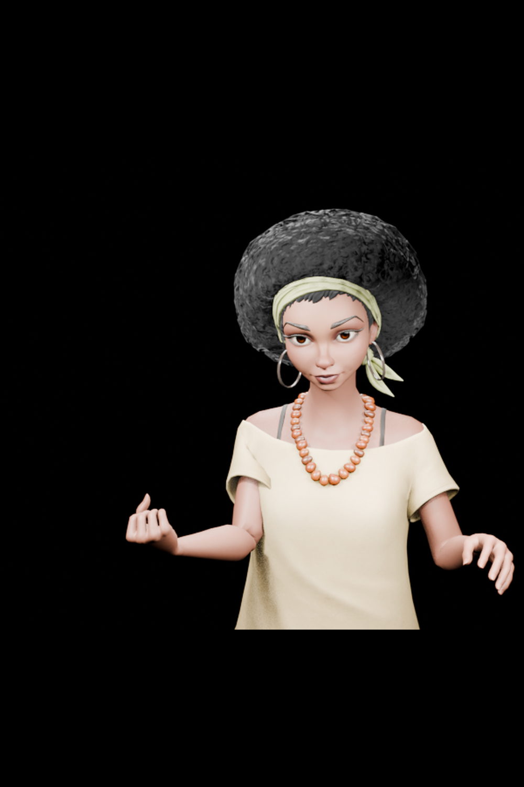       | [sign-yes-fiona.glb](https://github.com/bryanchasko/amazon-sumerian-hosts-asl/releases/download/v0.2-batch5/sign-yes-fiona.glb)             | PASS both — S fist at chest                                             |
| NO        | —                                                                                                                                                               | —                                                                                                                                                                                                                                                       | 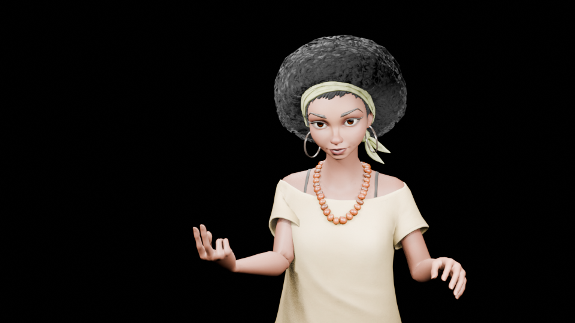            | [sign-no-fiona.glb](https://github.com/bryanchasko/amazon-sumerian-hosts-asl/releases/download/v0.2-batch5/sign-no-fiona.glb)               | —                                                                       |
| QUESTION  | —                                                                                                                                                               | —                                                                                                                                                                                                                                                       |       | [sign-question-fiona.glb](https://github.com/bryanchasko/amazon-sumerian-hosts-asl/releases/download/v0.2-batch5/sign-question-fiona.glb)   | —                                                                       |
| TRUE      | —                                                                                                                                                               | —                                                                                                                                                                                                                                                       | 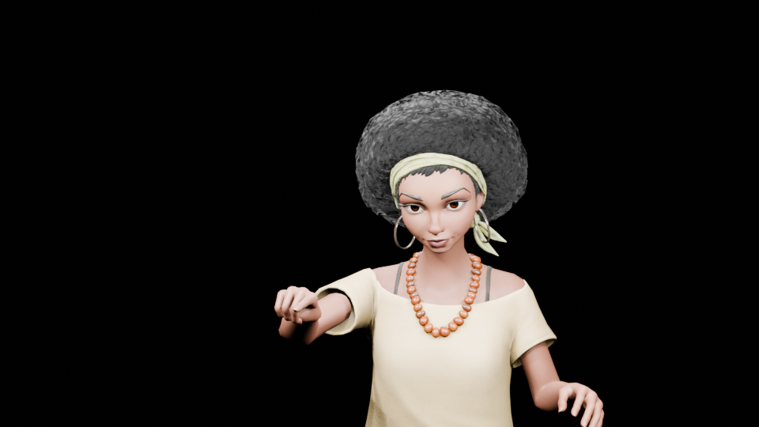          | [sign-true-fiona.glb](https://github.com/bryanchasko/amazon-sumerian-hosts-asl/releases/download/v0.2-batch5/sign-true-fiona.glb)           | —                                                                       |

| sign  | real world                                                                                                                                                           | Muse Image                                                                                                                                                                                                                                      | Fiona rig                                                    | clip                                                                                                                                | verdict                                           |
| ----- | -------------------------------------------------------------------------------------------------------------------------------------------------------------------- | ----------------------------------------------------------------------------------------------------------------------------------------------------------------------------------------------------------------------------------------------- | ------------------------------------------------------------ | ----------------------------------------------------------------------------------------------------------------------------------- | ------------------------------------------------- |
| ONE   | —                                                                                                                                                                    | —                                                                                                                                                                                                                                               |        | [sign-one-fiona.glb](https://github.com/bryanchasko/amazon-sumerian-hosts-asl/releases/download/v0.2-batch5/sign-one-fiona.glb)     | —                                                 |
| TWO   | —                                                                                                                                                                    | —                                                                                                                                                                                                                                               |        | [sign-two-fiona.glb](https://github.com/bryanchasko/amazon-sumerian-hosts-asl/releases/download/v0.2-batch5/sign-two-fiona.glb)     | —                                                 |
| THREE | —                                                                                                                                                                    | —                                                                                                                                                                                                                                               |      | [sign-three-fiona.glb](https://github.com/bryanchasko/amazon-sumerian-hosts-asl/releases/download/v0.2-batch5/sign-three-fiona.glb) | —                                                 |
| FOUR  | —                                                                                                                                                                    | —                                                                                                                                                                                                                                               |       | [sign-four-fiona.glb](https://github.com/bryanchasko/amazon-sumerian-hosts-asl/releases/download/v0.2-batch5/sign-four-fiona.glb)   | —                                                 |
| FIVE  | —                                                                                                                                                                    | —                                                                                                                                                                                                                                               | 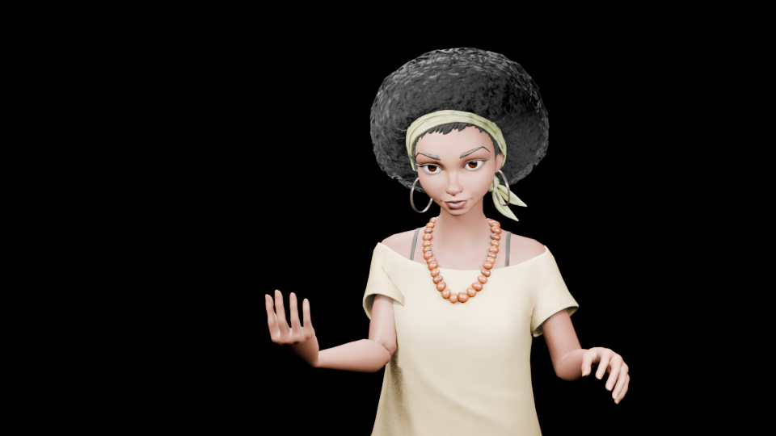      | [sign-five-fiona.glb](https://github.com/bryanchasko/amazon-sumerian-hosts-asl/releases/download/v0.2-batch5/sign-five-fiona.glb)   | —                                                 |
| SIX   | —                                                                                                                                                                    | —                                                                                                                                                                                                                                               |        | [sign-six-fiona.glb](https://github.com/bryanchasko/amazon-sumerian-hosts-asl/releases/download/v0.2-batch5/sign-six-fiona.glb)     | —                                                 |
| SEVEN | —                                                                                                                                                                    | —                                                                                                                                                                                                                                               | 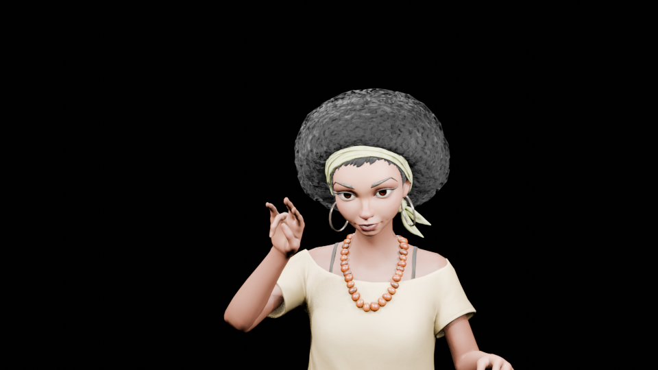     | [sign-seven-fiona.glb](https://github.com/bryanchasko/amazon-sumerian-hosts-asl/releases/download/v0.2-batch5/sign-seven-fiona.glb) | —                                                 |
| EIGHT | <a href="https://www.lifeprint.com/asl101/pages-signs/n/numbers1-10.htm"></a> | <details><summary>prompt</summary>muse-image-1.0 · POST /v1/images/generations<br>photorealistic adult woman signing ASL EIGHT, hands clearly visible, neutral background</details> |  | [sign-eight-fiona.glb](https://github.com/bryanchasko/amazon-sumerian-hosts-asl/releases/download/v0.2-batch5/sign-eight-fiona.glb) | AI FAIL — open V is a 2; rig PASS (zoom verified) |
| NINE  | —                                                                                                                                                                    | —                                                                                                                                                                                                                                               |       | [sign-nine-fiona.glb](https://github.com/bryanchasko/amazon-sumerian-hosts-asl/releases/download/v0.2-batch5/sign-nine-fiona.glb)   | —                                                 |

| sign     | real world                                                                                                                                             | Muse Image                                                                                                                                                                                                                                      | Fiona rig                                                    | clip                                                                                                                                      | verdict                            |
| -------- | ------------------------------------------------------------------------------------------------------------------------------------------------------ | ----------------------------------------------------------------------------------------------------------------------------------------------------------------------------------------------------------------------------------------------- | ------------------------------------------------------------ | ----------------------------------------------------------------------------------------------------------------------------------------- | ---------------------------------- |
| ME       | —                                                                                                                                                      | —                                                                                                                                                                                                                                               | 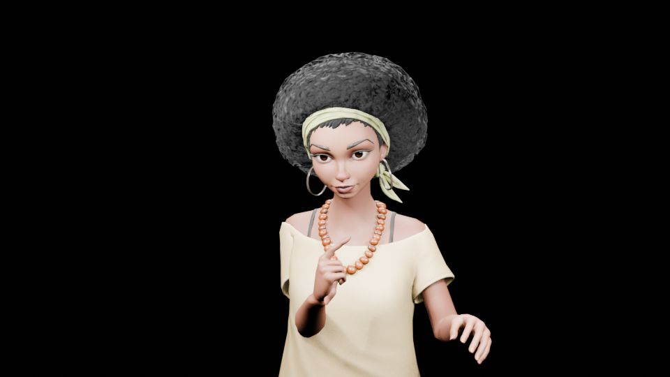        | [sign-me-fiona.glb](https://github.com/bryanchasko/amazon-sumerian-hosts-asl/releases/download/v0.2-batch5/sign-me-fiona.glb)             | —                                  |
| YOU      | —                                                                                                                                                      | —                                                                                                                                                                                                                                               | 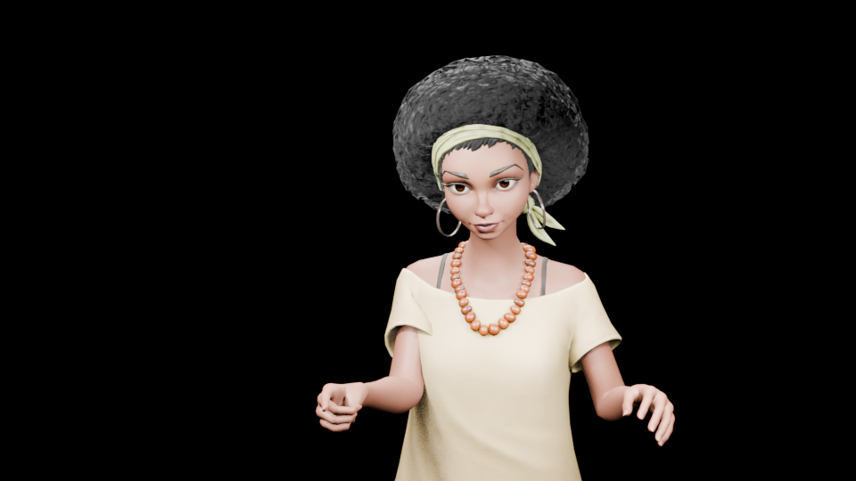       | [sign-you-fiona.glb](https://github.com/bryanchasko/amazon-sumerian-hosts-asl/releases/download/v0.2-batch5/sign-you-fiona.glb)           | —                                  |
| THIS     | —                                                                                                                                                      | —                                                                                                                                                                                                                                               | 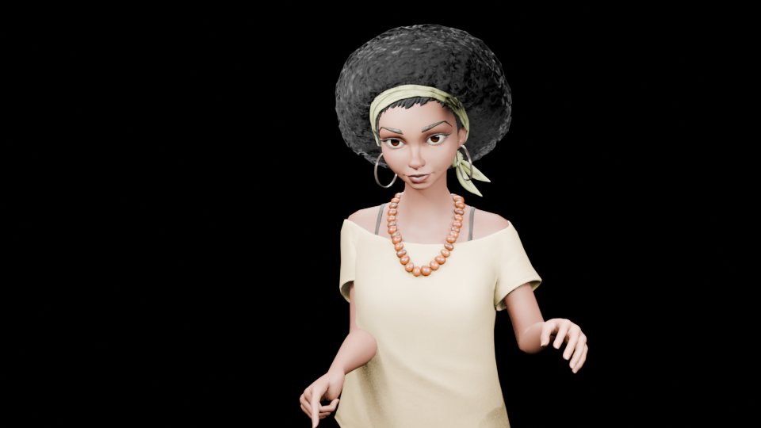      | [sign-this-fiona.glb](https://github.com/bryanchasko/amazon-sumerian-hosts-asl/releases/download/v0.2-batch5/sign-this-fiona.glb)         | —                                  |
| WHERE    | —                                                                                                                                                      | —                                                                                                                                                                                                                                               | 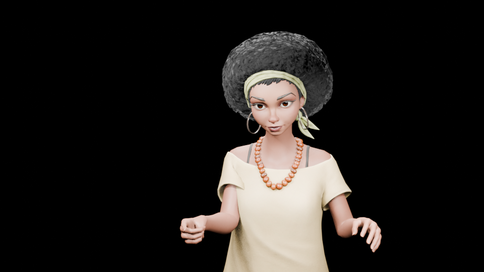     | [sign-where-fiona.glb](https://github.com/bryanchasko/amazon-sumerian-hosts-asl/releases/download/v0.2-batch5/sign-where-fiona.glb)       | —                                  |
| WHO      | —                                                                                                                                                      | —                                                                                                                                                                                                                                               | 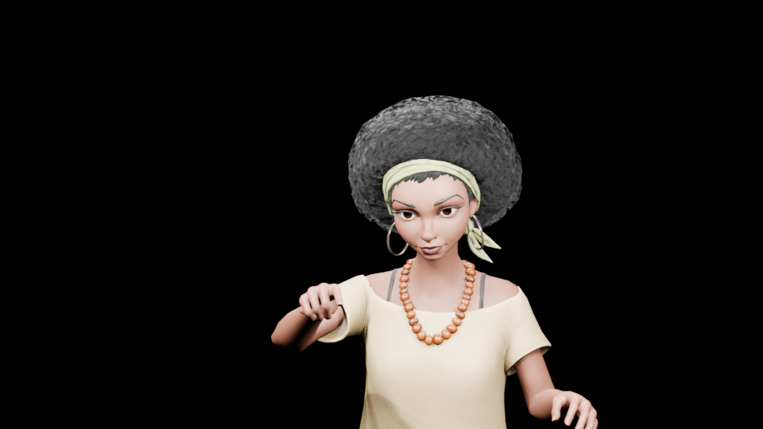       | [sign-who-fiona.glb](https://github.com/bryanchasko/amazon-sumerian-hosts-asl/releases/download/v0.2-batch5/sign-who-fiona.glb)           | —                                  |
| HOW-MANY | —                                                                                                                                                      | —                                                                                                                                                                                                                                               | 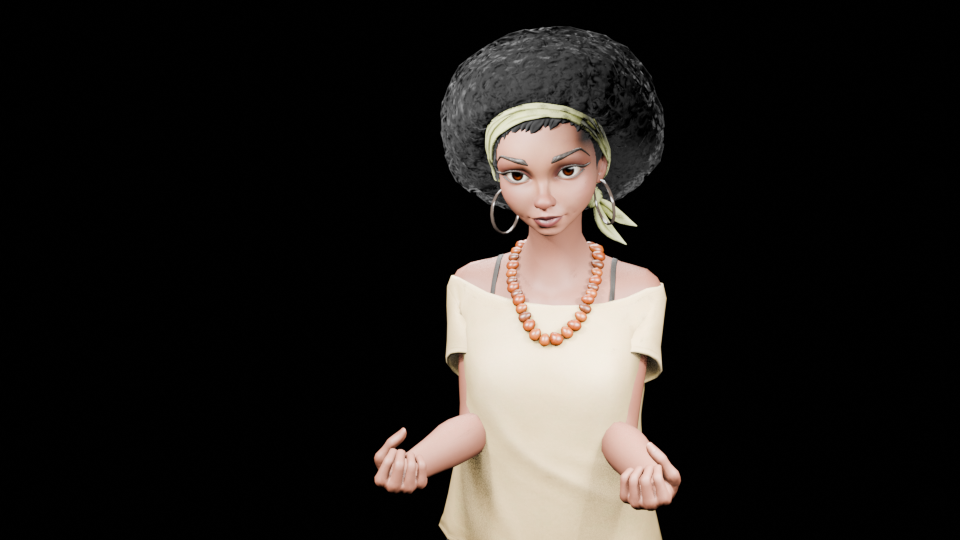  | [sign-how-many-fiona.glb](https://github.com/bryanchasko/amazon-sumerian-hosts-asl/releases/download/v0.2-batch5/sign-how-many-fiona.glb) | —                                  |
| FIRST    | <a href="https://www.lifeprint.com/asl101/pages-signs/f/first.htm"></a> | 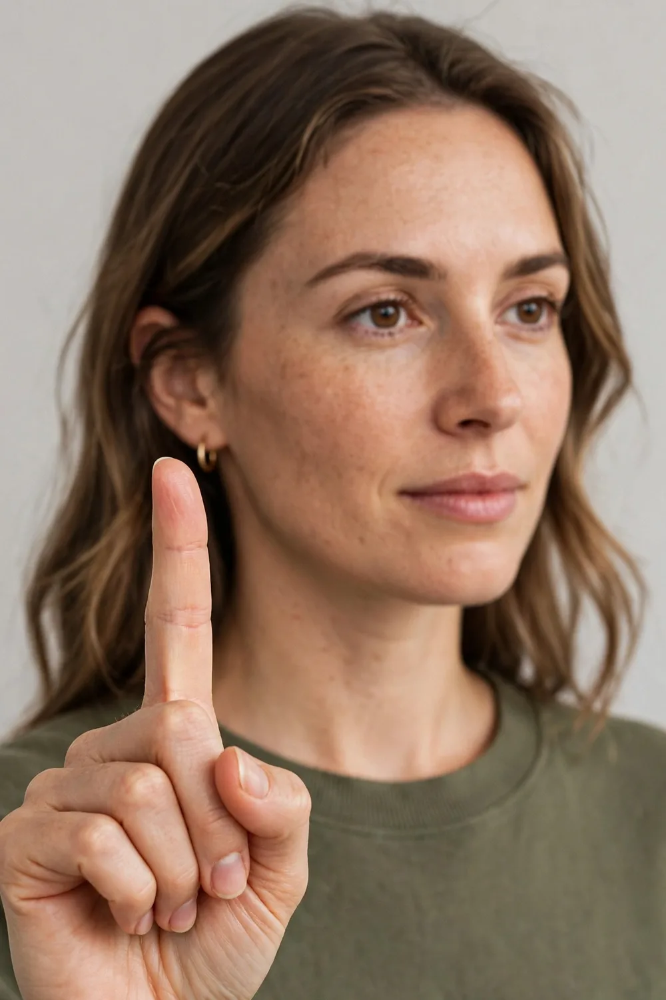<details><summary>prompt</summary>muse-image-1.0 · POST /v1/images/generations<br>photorealistic adult woman signing ASL FIRST, hands clearly visible, neutral background</details> | 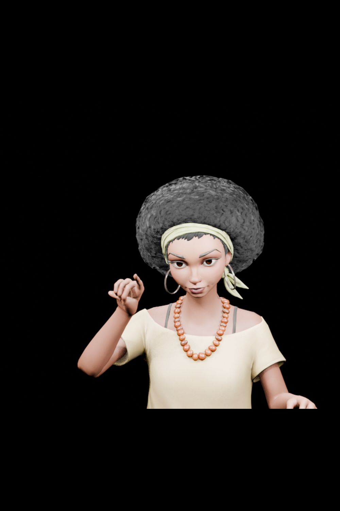 | [sign-first-fiona.glb](https://github.com/bryanchasko/amazon-sumerian-hosts-asl/releases/download/v0.2-batch5/sign-first-fiona.glb)       | PASS both — index up, palm forward |
| SECOND   | —                                                                                                                                                      | —                                                                                                                                                                                                                                               |     | [sign-second-fiona.glb](https://github.com/bryanchasko/amazon-sumerian-hosts-asl/releases/download/v0.2-batch5/sign-second-fiona.glb)     | —                                  |

Signs move — stills are citations. THANK-YOU looped; the rest play
from their clips above.


Second attempt, same session: the bare gloss prompt failed
THANK-YOU, so the pose knowledge went in with the image via
`/v1/images/edits` — once to fix the AI image, once to photoreal
the rig still. No ControlNet-style pose conditioning exists on the
API; the edits endpoint is the lever, and both pass. There is no
video generation endpoint on the Model API (video is input-only),
so motion still comes from the Blender pipeline. Full calls in
[`docs/ai-vs-rig/prompts.md`](docs/ai-vs-rig/prompts.md#round-2-edits-endpoint-same-session),
verdicts in
[`docs/ai-vs-rig/verdicts.md`](docs/ai-vs-rig/verdicts.md#round-2-edits-endpoint-same-session).

<table>
<tr><th>fix the AI image</th><th>photoreal the rig still</th></tr>
<tr><td></td><td></td></tr>
</table>

## Open Fiona in Blender and press play

Same result by hand:

1. Open Blender. Delete the default cube (`X`).
2. `File > Import > glTF 2.0`, pick `fiona.glb`. The Outliner shows
   one mesh plus one armature — the skeleton every clip moves.

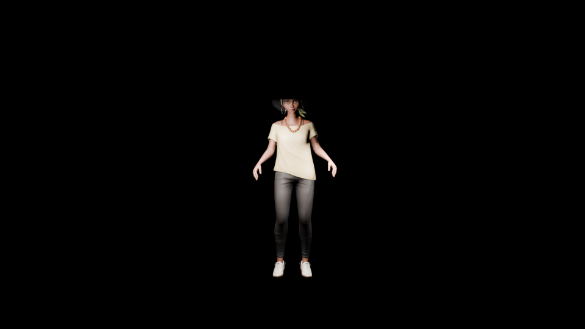

3. Select the armature, switch to **Pose Mode**. Rotating a bone
   poses the body — try the right wrist.
4. Pose the citation start: flat hand at the chin, fingertips at
   the lips (the numbers live in `SIGNS` in the scripts — the
   headless commands above set exactly this).

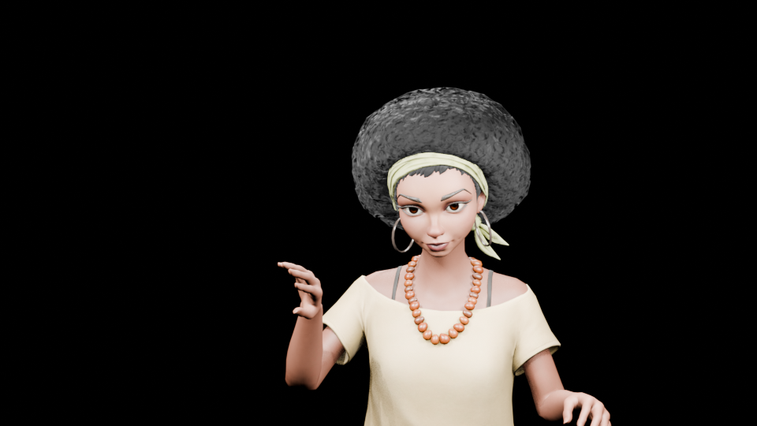

5. `File > Import > glTF 2.0`, pick `sign-thank-you-fiona.glb`
   (export it above, or grab the release). Ignore the second
   armature; open a Dope Sheet in Action Editor mode, select
   Fiona's armature, pick the `thank-you` action, drag to frame 36.

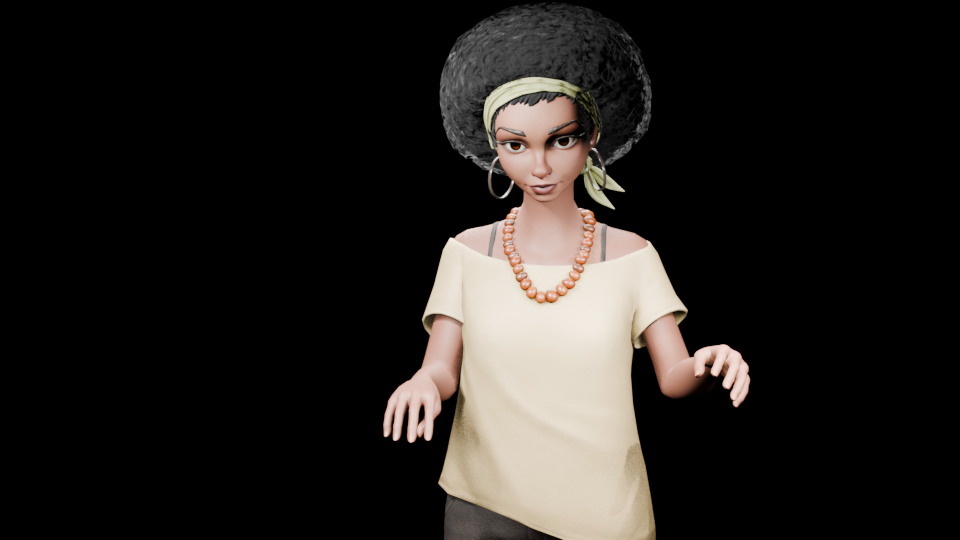

6. Press **Spacebar**. 72 frames: rest, chin hold, forward-down
   arc, palm-down end hold, return.

Playing an animation is an action (bone angles over frames)
assigned to an armature. The headless scripts do steps 4–5 with
numbers instead of mouse drags, so anyone reproduces the pose.

## Get a rig

**Option A — upstream open source.**
[aws-samples/amazon-sumerian-hosts](https://github.com/aws-samples/amazon-sumerian-hosts)
at `109baefef53cc18ef3e2e2340170c44078d011b91`, under
`packages/demos-babylon/src/character-assets/characters/adult_female/fiona/`.
Take the whole folder: `.gltf`, its `.bin`, `textures/`.

**Option B — vendored fixtures.** The sibling `sumerian-hosts`
repo keeps the same files at `fixtures/hosts/<id>/<id>.glb`:
`fiona`, `cristine`, `grace`, `maya`, `jay`, `luke`, `preston`,
`wes`, `alien`. Same upstream commit, same license.

Scripts default to the sibling fixtures path; `--rig fiona`
picks this guide's rig. Any rig with the same bone names works —
same skeleton, same names. Character files are CC BY-SA 4.0
(Amazon Web Services, Inc.); scripts and docs here are Apache-2.0.
Keep the attribution if you ship.

## How a sign is built

Four cheremes per sign — meaningless parts that combine into
meaning, like phonemes in speech:

- **Handshape** — which fingers extend, how the rest fold. A
  fist with thumb alongside is A; flat hand together is B;
  thumb-index circle is F. Every joint angle lives in
  `scripts/spike-finger-articulation/pose_handshapes.py`, one
  dict per shape.
- **Place** — chin (THANK-YOU), beside forehead (HELLO), chest
  (YOU), mouth (WHO).
- **Movement** — forward-down arc (THANK-YOU), pinwheel
  (HELLO), forward point (YOU).
- **Palm direction** — palm-out on letters, dorsal on isolated
  numbers 1–5. Presets `letter_or_digit` and `cardinal_numeral`
  cover nearly everything; full table in the
  [cookbook](docs/cookbook.md) ("How to read a pose").

A host line becomes an ASL gloss sequence — one token per sign,
in ASL order, fingerspelling where the lexicon has no entry:

```json
["YOU", "THANK-YOU", "FINGERSPELL:H-E-L-P"]
```

```bash
python3 scripts/validate_gloss.py data/examples/gloss-demo.json
python3 scripts/lint_lexicon.py
```

Rules in [`docs/gloss-schema.md`](docs/gloss-schema.md).
Out-of-lexicon words degrade to letters, never to made-up
gestures. The authoring loop: change the numbers in `SIGNS` /
`SIGNS_END`, re-run the two commands, compare against the
citation. The [cookbook](docs/cookbook.md) records every still's
numbers.

At runtime nothing about the engine changes: each sign is one
short clip on the same skeleton, queued in / hold / out beside
the gesture queue, on the same clock as banked audio + visemes.

## Built with Meta

Every row ran in this repo's dev loop; evidence linked. No Meta
model runs in production on the demo page — the site serves banked
audio and prebuilt clips.

| Model                       | What it did here                                                                                                                  | Evidence                                                                                                                     |
| --------------------------- | --------------------------------------------------------------------------------------------------------------------------------- | ---------------------------------------------------------------------------------------------------------------------------- |
| Muse Spark (via Muse Code)  | orchestration; drafted the gloss for "Hello! Yes, thank-you for coming." — validators pass (GLOSS PASS 4 tokens, LEXICON PASS 58) | [`gloss-draft.md`](docs/meta-evidence/gloss-draft.md), [`gloss-draft-spark.json`](docs/meta-evidence/gloss-draft-spark.json) |
| Muse Wonder (via Muse Code) | planned the work, set the verdict rubric, reviewed every evidence table                                                           | [`wonder-notes.md`](docs/meta-evidence/wonder-notes.md), [`verdicts.md`](docs/ai-vs-rig/verdicts.md)                         |
| Muse Image (API)            | 5-sign comparison set (prompts + payloads verbatim), demo poster, 2 round-2 edits — both pass                                     | [`prompts.md`](docs/ai-vs-rig/prompts.md), [`demo-poster.webp`](docs/assets/demo-poster.webp)                                |
| Muse Voice Transcribe (API) | timing audit: banked "thank you" turn 0.140–0.380 s inside the gesture in-phase                                                   | [`transcribe-audit.md`](docs/meta-evidence/transcribe-audit.md)                                                              |
| SAM 3.1 (API)               | hand-segmentation QA on all 10 images; capacity 429s, zero masks — verdicts inspected, rerun queued                               | [`verdicts.md`](docs/ai-vs-rig/verdicts.md)                                                                                  |
| Muse Glimmer (local)        | same gloss task on-device; too slow to finish (fragment recorded as a limitation)                                                 | [`gloss-glimmer-raw.json`](docs/meta-evidence/gloss-glimmer-raw.json)                                                        |
| Muse Code                   | the agent that wrote it all                                                                                                       | repo history                                                                                                                 |

Heavy models ran in the dev loop; the page serves their
outputs, so nothing bills per request. The reproducible core
stays the headless scripts: same numbers in, same pixels out, no
model in the loop at render time.

### Run the local stack yourself

- **Muse Code** (agent, drives everything): any Mac/Linux box.
  `curl -fsSL https://dev.meta.ai/install.sh | sh`, then `muse`
  in the repo and sign in. Non-interactive use takes
  `MODEL_API_KEY` instead.
- **Muse Spark** (the model behind the agent): the same key over
  `https://api.meta.ai/v1` — point any OpenAI-compatible client
  at it. Contributor-mode models cost less per token.
- **A local open-weights model** (we used Glimmer 30B for gloss
  drafts): any OpenAI-compatible server on your own hardware —
  ~20 GB free for a 30B quant (vLLM, SGLang, or llama.cpp all
  serve one). Query it the same way you would the API; keep the
  repo validators as the gate, not the model's word.
- **A vision model for second opinions** (we used Ollama vision
  models for render-vs-citation checks): install
  [Ollama](https://ollama.com), `ollama pull` a vision model,
  show it the render next to the citation still and ask what
  differs. It catches pose drift a tired eye misses; the human
  reviewer still decides.

### Inspect a live scene over HTTP (Blender MCP)

The `blender-mcp` bridge (v1.29.1 answered here) exposes the open
Blender file as MCP tools over Streamable HTTP. Replicate it:
open your `.blend` in a Blender with the MCP addon enabled and
connected — it listens on `127.0.0.1:8190/mcp`. Every call below
is read-only; the bridge answers about whatever file that Blender
has open.

Handshake (returns a session id — real reply from this box):

```bash
curl -X POST http://127.0.0.1:8190/mcp \
  -H "Content-Type: application/json" \
  -H "Accept: application/json, text/event-stream" \
  -d '{"jsonrpc":"2.0","id":1,"method":"initialize",
       "params":{"protocolVersion":"2025-06-18","capabilities":{},
       "clientInfo":{"name":"my-probe","version":"0.1"}}}'
# 200, serverInfo: {"name":"blender-mcp","version":"1.29.1"},
# header mcp-session-id: <SID>
```

List tools, then ask what is in the scene:

```bash
curl -X POST http://127.0.0.1:8190/mcp \
  -H "Content-Type: application/json" \
  -H "Accept: application/json, text/event-stream" \
  -H "mcp-session-id: <SID>" \
  -d '{"jsonrpc":"2.0","id":2,"method":"tools/list","params":{}}'
# tools include: get_objects_summary, get_object_detail_summary,
# render_viewport_to_path, search_api_docs, execute_blender_code ...

curl -X POST http://127.0.0.1:8190/mcp \
  -H "Content-Type: application/json" \
  -H "Accept: application/json, text/event-stream" \
  -H "mcp-session-id: <SID>" \
  -d '{"jsonrpc":"2.0","id":3,"method":"tools/call",
       "params":{"name":"get_objects_summary","arguments":{}}}'
# {"status":"ok","scene_name":"Scene","active_object":"Cube",
#  "collections":[{"name":"Scene Collection", ...,"objects":
#  [{"name":"Camera","type":"CAMERA",...},
#   {"name":"Cube","type":"MESH",...},
#   {"name":"Light","type":"LIGHT",...}] ...}]}
```

That reply came from a default scene — open Fiona's file in the
bridged Blender and the same call lists her mesh, armature, and
bones. `get_object_detail_summary` drills into one bone;
`render_viewport_to_path` snapshots the viewport without the
headless scripts.

### Re-run the hosted calls yourself

One key (`MODEL_API_KEY` from dev.meta.ai), same base URL
throughout: `https://api.meta.ai/v1`. Outputs are committed above;
re-running only matters if you change the inputs.

Generate (exact call behind the comparison set):

```bash
curl -X POST "https://api.meta.ai/v1/images/generations" \
  -H "Authorization: Bearer $MODEL_API_KEY" \
  -H "Content-Type: application/json" \
  -d '{"model":"muse-image-1.0",
       "prompt":"photorealistic adult woman signing ASL THANK-YOU, hands clearly visible, neutral background"}'
# {"data":[{"b64_json":"..."}]} — 1280x1920 webp
```

Edit with a reference image (exact round-2 call — the one that
fixed the palm):

```bash
curl -X POST "https://api.meta.ai/v1/images/edits" \
  -H "Authorization: Bearer $MODEL_API_KEY" \
  -F 'model=muse-image-1.0' \
  -F 'image=@ai-thank-you.png' \
  -F 'prompt=Keep the same woman, framing and neutral background. Fix
      only her signing hand: flat hand at the chin, fingertips touching
      the chin, palm facing toward her, the ASL sign for thank-you.'
# {"data":[{"b64_json":"..."}]} — palm corrected, rest intact
```

Transcribe with turn timing (exact audit call — `ENDPOINTING`
is what returns turns; `PUSH_TO_TALK` returns none):

```bash
curl -X POST "https://api.meta.ai/v1/asr/transcribe" \
  -H "Authorization: Bearer $MODEL_API_KEY" \
  -H "Accept: application/json" \
  -F 'request={"model":"muse-voice-transcribe-1.0","audioEncoding":"WAV","mode":"ENDPOINTING"};type=application/json' \
  -F "audio=@thank-you.wav;type=audio/wav"
# {"transcript":"Thank you","audioDurationMs":880,
#  "turns":[{"turnId":0,"startMs":140,"endMs":380,...}]}
```

Segment hands (validated shape; expect 429s until capacity
recovers — every attempt here did):

```bash
curl -X POST "https://api.meta.ai/v1/responses" \
  -H "Authorization: Bearer $MODEL_API_KEY" \
  -H "Content-Type: application/json" \
  -d '{"model":"sam-3.1","stream":false,
       "input":[{"role":"user","content":[
         {"type":"input_text","text":"hands"},
         {"type":"input_image","image_url":"https://.../ai-vs-rig/cmp/cmp-yes-ai.webp"}]}]}'
# masks arrive as <|box;...|> + <|mask;...|> tokens in output_text
```

Live demo: <https://bryanchasko.com/signing-hosts/?host=fiona&shot=signing>
