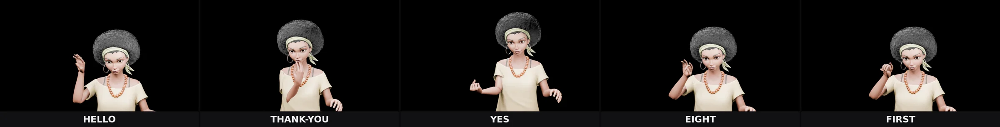
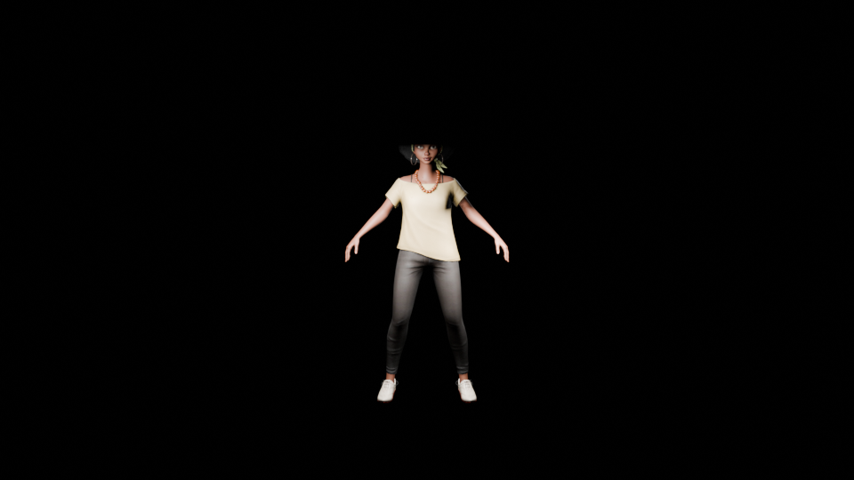
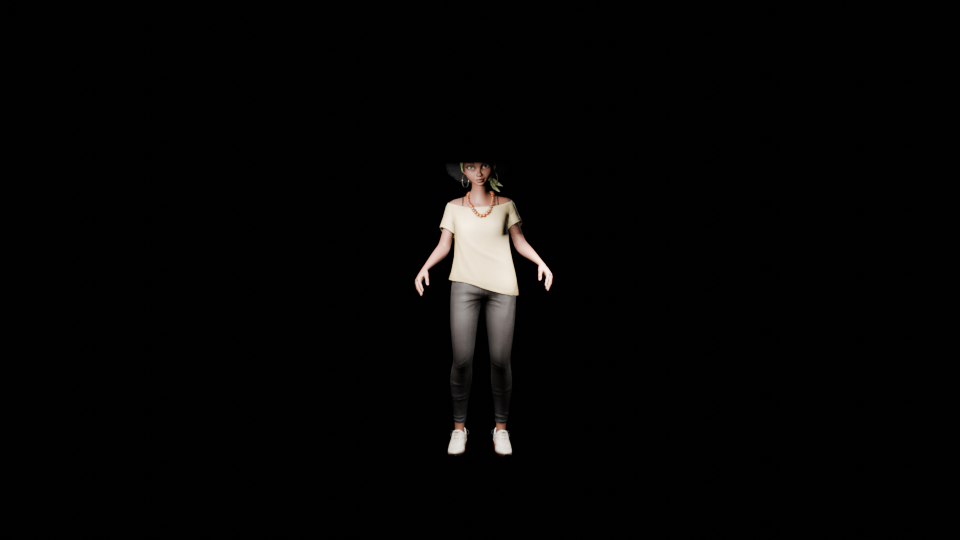
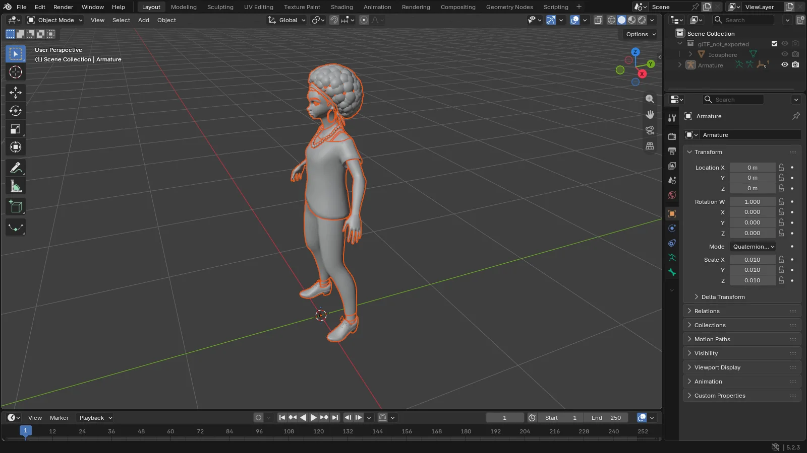
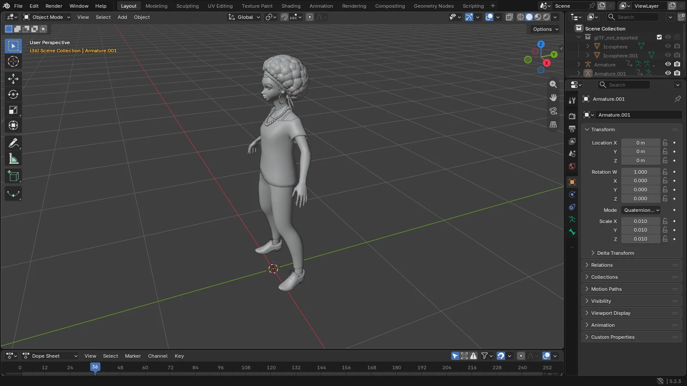
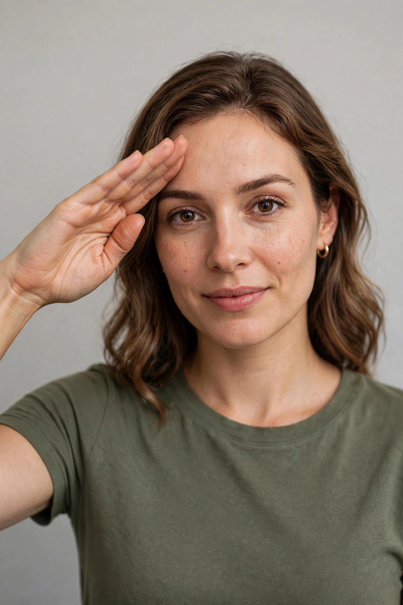
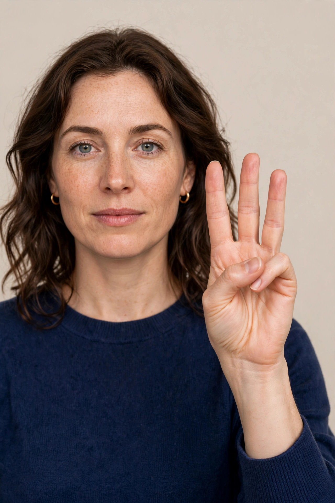

# Blender Sign Studio (ASL)

Build signing game characters, tutors, VTubers. Base: open
source Amazon Sumerian Hosts SDK, Babylon.js. Contents:
58-gloss ASL lexicon, 23 reviewed engine clips on the Fiona
rig, reference 3D hand rigs per sign.
[Watch it run](https://bryanchasko.com/signing-hosts/?host=fiona&shot=signing):
live page, host signing.
[All 23 clips](https://github.com/bryanchasko/blender-sign-studio-asl-public/releases/tag/v0.2-batch5):
finished .glb files. The tutorial builds them below — start
there, skip ahead only to compare.
[Issues](https://github.com/bryanchasko/blender-sign-studio-asl-public/issues):
report breaks, request ports.
Apache-2.0 (code/docs), CC BY-SA 4.0 (meshes).

Status: initial placeholders. Hand-adjust in Blender or
fine-tune programmatically before calling any sign correct.
Breadth is the win: 58 labeled, close signs as in-Blender
references. No starting from scratch.

Method: Muse Code workflows split the work across focused
subagents — renders, lexicon, evidence tables, site — while
the team bakes hero signs upstream. Same pattern scales to
new sign packs.

One host line plays three ways at once: spoken, captioned,
signed. All three share one clock. Path: watch it, play it in
Blender, export one clip.
[Watch it run](https://bryanchasko.com/signing-hosts/?host=fiona&shot=signing):
the live page plays the host signing.
[All 23 clips](https://github.com/bryanchasko/blender-sign-studio-asl-public/releases/tag/v0.2-batch5):
every .glb, no Blender needed.
[Issues](https://github.com/bryanchasko/blender-sign-studio-asl-public/issues):
report a break, request a port.
Apache-2.0 (code/docs), CC BY-SA 4.0 (meshes).


The live page: sign picker, sign deck with practice rings,
timeline with gather-hold-release, slow-mo. Recapture any
time — command in `assets/README.md`.

## Requirements

Three things: Blender 5.2 Long Term Support (LTS),
Python 3, a rig file (see Get a rig). Install Blender once:

```bash
mkdir -p ~/opt && cd ~/opt
curl -sSO https://download.blender.org/release/Blender5.2/blender-5.2.3-linux-x64.tar.xz
tar xf blender-5.2.3-linux-x64.tar.xz
ln -sfn ~/opt/blender-5.2.3-linux-x64/blender ~/.local/bin/blender-5.2
blender-5.2 --version   # Blender 5.2.3 LTS
```

The installer creates `~/.local/bin/blender-5.2`. Put it on
PATH (`export PATH="$HOME/.local/bin:$PATH"`), or the Try-it
commands fail with `command not found`.

## Concepts in 60 seconds

| Word    | Meaning                                                             |
| ------- | ------------------------------------------------------------------- |
| host    | One animated 3D character. Fiona hosts Blender signing here.        |
| gloss   | Written label for one sign, capitals. Example: `THANK-YOU`.         |
| chereme | One dictionary sign as one short animation. Handshape, place,       |
|         | movement, palm direction baked in.                                  |
| clip    | One exported chereme file (`.glb`, 72 frames at 24 fps). The engine |
|         | plays it.                                                           |
| rig     | Skeleton file the clip is built on. Rigs live outside this repo     |
|         | (see Get a rig). Citation form: the dictionary performance of a     |
|         | sign. Every compared row links its Lifeprint page.                  |

- **Kinematics.** A pose is three joint angles per arm
  (shoulder/elbow/wrist, radians) plus a named handshape. All 23
  live in `SIGNS`/`SIGNS_END` in
  `scripts/blender/render_host_shots.py`. Per-gloss values sit in
  [`docs/ai-vs-rig/scorecards.md`](docs/ai-vs-rig/scorecards.md) —
  read it before touching a number.
- **Engine.** Binary glTF (.glb) holds an action: bone angles
  per frame. The engine retargets each clip onto the host
  skeleton. It bakes the clip additive.
- **Meta Model API.** Base URL `https://api.meta.ai/v1` plus a
  `MODEL_API_KEY` from dev.meta.ai. Used here: Muse Image
  (comparison set, poster, round-2 edits), Muse Voice
  Transcribe (turn 0.140–0.380 s lands inside the gesture
  in-phase), Segment Anything Model 3.1 (SAM 3.1) for
  segmentation QA (capacity-blocked all day), Muse Spark
  (gloss drafts via Muse Code). No model runs in production.
  The page serves committed outputs.

A rig is mesh over an armature: bones move, mesh follows.
(Muse Image's idea of one lives in
[`docs/assets/concepts-illustration.webp`](docs/assets/concepts-illustration.webp) —
portrait poster, kept out of this flow.)

## Get a rig

**Option A — upstream open source.** The canonical rigs live in
[aws-samples/amazon-sumerian-hosts](https://github.com/aws-samples/amazon-sumerian-hosts)
at `109baefef53cc18ef3e2e2340170c44078d011b91`, under
`packages/demos-babylon/src/character-assets/characters/adult_female/fiona/`.
Take the whole folder: `.gltf`, its `.bin`, `textures/`.

**Option B — vendored fixtures.** The sibling `sumerian-hosts`
repository keeps the same files at `fixtures/hosts/<id>/<id>.glb`:
`fiona`, `cristine`, `grace`, `maya`, `jay`, `luke`, `preston`,
`wes`, `alien`. Same upstream commit, same license.

Scripts default to the sibling fixtures path. Point them
elsewhere with `RIG_DIR=/path/to/fixtures`. Pass `--rig fiona`
for this guide's rig. Any rig with the same bone names
fits, so one rig fits every clip. Rig files are CC BY-SA
4.0 (Amazon Web Services, Inc.). Scripts and docs here are
Apache-2.0. The license requires attribution on ship.

## Try it: THANK-YOU in three commands

Prerequisite: the rig file from Get a rig above. Run every
command with `blender-5.2` from Requirements. A system
`blender` is usually the wrong version.

Render the citation still. Run from the repo root:

```bash
blender-5.2 -b --factory-startup --python-exit-code 1 \
  -P scripts/blender/render_host_shots.py -- \
  --out-dir out --shot sign-thank-you --rig fiona
# RENDER_OK out/spike-sign-thank-you.png posed=36
```

Export the 72-frame engine clip:

```bash
blender-5.2 -b --factory-startup --python-exit-code 1 \
  -P scripts/blender/export_sign_clip.py -- \
  --sign thank-you --rig fiona --out out/sign-thank-you-fiona.glb
# CLIP_OK out/sign-thank-you-fiona.glb action=thank-you
```

Play the clip in Blender: open Blender, delete the cube,
import `fiona.glb` via `File > Import > glTF 2.0`, import
`sign-thank-you-fiona.glb` the same way, open a Dope Sheet,
switch it to Action Editor, select Fiona's armature, pick the
`thank-you` action, drag to frame 36, press **Spacebar**.
The full tour with screenshots sits in
[Press play in the Blender window](#press-play-in-the-blender-window)
below.

The first script reports `RENDER_OK` and `posed=36`: 36
bones posed. The second reports `CLIP_OK`: it exported only the
`thank-you` action. Skip the export step: grab ready-made clips
from the
[release assets](https://github.com/bryanchasko/blender-sign-studio-asl-public/releases).
Release files travel through the asset pipeline, never git.

<table>
<tr><th>citation start</th><th>end hold</th></tr>
<tr><td></td><td></td></tr>
</table>

Flat hand at the chin, fingertips at the lips. Forward-down arc
to the palm-down end hold (frames 44–52 of 72). Re-render these
exact pixels any time with the first command above.

## The signs: 58 glosses, 23 reviewed and clipped



The lexicon holds 58 glosses: 23 reviewed with engine clips,
35 proposed ([lexicon JSON](data/lexicon/lexicon.v1.json)). The
full per-sign table — reference, Muse Image call, rig still,
clip, verdict — lives in
[`docs/reviewed-signs.md`](docs/reviewed-signs.md).

Signs move — stills are citations. All five compared signs loop
below (48 frames, 24 fps, Blender-rendered, served from S3; the
engine clip stays 72 frames, the loop excerpts 48). Render your
own — only these five exist as move shots — then assemble it:

```bash
blender-5.2 -b --factory-startup --python-exit-code 1 \
  -P scripts/blender/render_host_shots.py -- \
  --out-dir out --shot sign-hello-move --rig fiona
# RENDER_OK out/sign-hello-move frames=48
ffmpeg -framerate 24 -i out/sign-hello-move/frame_%04d.png \
  -vf scale=480:-1 -loop 0 hello.webp
```

<table>
<tr><th>hello</th><th>thank-you</th><th>yes</th><th>eight</th><th>first</th></tr>
<tr><td></td><td></td><td></td><td></td><td></td></tr>
</table>

Stance between signs: neutral idle, arms slightly out (left) vs
arms down (right). Rest bakes into the idle base upstream (pull
requests #107–111). The rest-idle export tooling lives there too
(port queue: [issue #2](https://github.com/bryanchasko/blender-sign-studio-asl-public/issues/2)).
Stills ported from upstream origin/main
`docs/assets/batch9/`. The upstream team eye-verified them there.

<table>
<tr><th>stand idle rest</th><th>rest arms down</th></tr>
<tr><td></td><td></td></tr>
</table>

## Press play in the Blender window



The real Blender window — menus, viewport, outliner, timeline.
Capture protocol in [`assets/README.md`](assets/README.md).

In the Blender window (open Blender 5.2, not system
`blender`):

1. Open Blender. Delete the default cube (`X`, then `Enter`).
2. Import `fiona.glb` from Get a rig (default
   `~/code/chasko-labs/sumerian-hosts/fixtures/hosts/fiona/fiona.glb`,
   or wherever `RIG_DIR` points) via `File > Import > glTF 2.0`.
   The Outliner shows the rig's meshes plus one armature. The
   armature is the skeleton every clip moves.
3. Select the armature. Switch to Pose Mode (mode dropdown in
   the viewport header). Rotate a bone. Try the right wrist.
4. Compare the viewport against the citation still in Try it.
   The numbers live in `SIGNS`. The headless commands above set
   exactly this pose.
5. Import `sign-thank-you-fiona.glb` the same way (exported
   to `out/` in Try it, or grab it from the release assets).
   Ignore the second armature — it rode in with the clip file;
   only Fiona's moves the mesh. Open a Dope Sheet (editor-type
   selector, top-left icon). Switch it to Action Editor. Select
   Fiona's armature. Pick the `thank-you` action. Drag the
   playhead to frame 36.
6. Press **Spacebar**. Spacebar plays 72 frames: rest, chin
   hold, forward-down arc, palm-down end hold, return.
7. Tweak: in Pose Mode rotate the right wrist, note the new
   angles, copy them into `SIGNS`, re-run the export. The
   validators re-check the draft.



Frame 36 in the window: rest mesh up top, thank-you keys
in the Dope Sheet, playhead at 36. The clip is engine-relative
— it needs the gesture-queue base to pose the mesh, so Blender
shows the setup while the render shows the pose. Same protocol
as the import shot.

An animation is an action: bone angles over frames, assigned to
an armature. The headless scripts set steps 4–5 with numbers
instead of mouse drags. Same pose either way.


## How a sign is built

Four cheremes per sign. Meaningless parts combine into meaning,
like phonemes in speech:

- **Handshape** — which fingers extend, how the rest fold. A
  fist with thumb alongside is A. Flat hand together is B.
  Thumb-index circle is F. Every joint angle lives in
  `scripts/spike-finger-articulation/pose_handshapes.py`, one
  dict per shape.
- **Place** — chin (THANK-YOU), beside forehead (HELLO), chest
  (YOU), mouth (WHO).
- **Movement** — forward-down arc (THANK-YOU), pinwheel
  (HELLO), forward point (YOU).
- **Palm direction** — palm-out on letters, dorsal on isolated
  numbers 1–5. Presets cover nearly everything. The full table
  lives in the [cookbook](docs/cookbook.md) ("How to read a
  pose") — open it when a preset looks wrong.

Turn a host line into a gloss sequence. One token per sign,
ASL order. Fingerspell what the lexicon lacks:

```json
["YOU", "THANK-YOU", "FINGERSPELL:H-E-L-P"]
```

Check a draft with two commands:

```bash
python3 scripts/validate_gloss.py data/examples/gloss-demo.json
python3 scripts/lint_lexicon.py
```

The token rules live in
[`docs/gloss-schema.md`](docs/gloss-schema.md) — check them
before drafting. Author a sign like this: change the numbers
in `SIGNS` / `SIGNS_END`. Re-run the two commands. Compare
against the citation. The [cookbook](docs/cookbook.md) records
every still's numbers, so start there when a pose looks off.

Gate: pass AI review before any clip is labeled ASL
([docs/ai-review.md](docs/ai-review.md)). Propose any lexicon
gloss. Never improvise a sign. Never label a generic gesture
clip as ASL.

One gloss, start to finish:

```bash
python3 scripts/validate_gloss.py data/examples/gloss-demo.json
# GLOSS PASS — tokens legal
blender-5.2 -b --factory-startup --python-exit-code 1 \
  -P scripts/blender/export_sign_clip.py -- \
  --sign thank-you --rig fiona --out out/sign-thank-you-fiona.glb
# CLIP_OK — baked
# Blender: import fiona.glb + sign-thank-you-fiona.glb,
# Action Editor > thank-you, Spacebar
```

At runtime the engine needs nothing new. Each sign is one short
clip on the same skeleton. It queues in/hold/out beside the
gesture queue. It runs on the same clock as banked audio and
visemes.

## Docs route map

- [`docs/architecture.md`](docs/architecture.md) — pipeline and host foundations, so speech, captions, and signs share one clock in your head.
- [`docs/cookbook.md`](docs/cookbook.md) — joint values and code samples, so you author exact poses.
- [`docs/gloss-schema.md`](docs/gloss-schema.md) — token rules, so entries validate.
- [`docs/asl-gloss-core-rules.md`](docs/asl-gloss-core-rules.md) — plain-language gloss primer, so lines stay legal.
- [`docs/ai-review.md`](docs/ai-review.md) — the review gate, so you know the bar before starting.
- [`docs/reviewer-guide.md`](docs/reviewer-guide.md) — signer path, so a fluent signer can join review.
- [`docs/reviewed-signs.md`](docs/reviewed-signs.md) — full per-sign table, so every verdict stays inspectable.
- [`docs/roadmap.md`](docs/roadmap.md) — build plan, so you see what is done and next.
- [`docs/decisions/`](docs/decisions/) — architecture records, so choices stay learnable.
- [`docs/credits.md`](docs/credits.md) — reference attribution, so sources stay cited.

## Built with Meta

Every row ran while building this project. The table links the
evidence. The reproducible core stays the headless scripts:
same numbers in, same pixels out. No model renders a frame. The
page serves banked audio and prebuilt clips. Nothing bills per
request.

| Model                       | What it did here                                                                                                                           | Evidence                                                                                                                     |
| --------------------------- | ------------------------------------------------------------------------------------------------------------------------------------------ | ---------------------------------------------------------------------------------------------------------------------------- |
| Muse Spark (via Muse Code)  | orchestration; drafted the gloss for "Hello! Yes, thank-you for coming." — validators pass (GLOSS PASS 20 tokens, LEXICON PASS 58 entries) | [`gloss-draft.md`](docs/meta-evidence/gloss-draft.md), [`gloss-draft-spark.json`](docs/meta-evidence/gloss-draft-spark.json) |
| Muse Wonder (via Muse Code) | planned the work, set the verdict rubric, reviewed every evidence table                                                                    | [`wonder-notes.md`](docs/meta-evidence/wonder-notes.md), [`verdicts.md`](docs/ai-vs-rig/verdicts.md)                         |
| Muse Image (API)            | 5-sign comparison set (prompts + payloads verbatim), demo poster, round-2 edits (both pass), round-3 (hello fixed, eight resists)          | [`prompts.md`](docs/ai-vs-rig/prompts.md), [`demo-poster.webp`](docs/assets/demo-poster.webp)                                |
| Muse Voice Transcribe (API) | timing audit: banked "thank you" turn 0.140–0.380 s inside the gesture in-phase                                                            | [`transcribe-audit.md`](docs/meta-evidence/transcribe-audit.md)                                                              |
| SAM 3.1 (API)               | hand-segmentation QA on all 10 images; capacity 429s, zero masks — verdicts inspected, rerun queued                                        | [`verdicts.md`](docs/ai-vs-rig/verdicts.md)                                                                                  |
| Muse Glimmer (local)        | same gloss task on-device; too slow to finish (fragment recorded as a limitation)                                                          | [`gloss-glimmer-raw.json`](docs/meta-evidence/gloss-glimmer-raw.json)                                                        |
| Muse Code                   | the agent that wrote it all                                                                                                                | commit history                                                                                                               |

### Demo 1 — Muse Spark drafts gloss, validators gate it

A gloss is one written token per sign, in ASL order — the
script the engine bakes into clips. Spark read the English
line and proposed the token sequence. The validators decide:
every token must exist in the lexicon. The model proposes,
the validators dispose.

Run the validators on the committed draft:

```bash
python3 scripts/validate_gloss.py docs/meta-evidence/gloss-draft-spark.json
# GLOSS PASS: 20 tokens across 1 files, 0 failures (ship=False)
python3 scripts/lint_lexicon.py
# LEXICON PASS: 58 entries, 0 failures
```

The draft lives in
[`gloss-draft-spark.json`](docs/meta-evidence/gloss-draft-spark.json)
(`HELLO YES THANK-YOU C-O-M-I-N-G` for "Hello! Yes, thank-you for
coming."). The model proposes. The validators dispose.

### Demo 2 — Muse Wonder plans, the rubric reviews

Read the plan, delegation, and verdict rubric in
[`wonder-notes.md`](docs/meta-evidence/wonder-notes.md) — it
decided what counts as a PASS. The sign-off sits in
[`verdicts.md`](docs/ai-vs-rig/verdicts.md).

### Demos 3–6 — hosted calls, one key

One key (`MODEL_API_KEY`). Same base URL:
`https://api.meta.ai/v1`. Get a key at dev.meta.ai: sign up,
open API keys, create one, then `export MODEL_API_KEY=...`.
Outputs are committed above. Rerun a call only when you change
its inputs.

The Image column below is the foil, never the reference.
Each side is judged against the Lifeprint citation first.

Right hand, wrong sign: the AI failures are chereme errors
(palm, handshape), none anatomical. Segment Anything Model 3.1
(SAM 3.1) masks rate-limited out, so these verdicts are
inspected, not segmented.

Second and third attempts: the bare gloss prompt failed
THANK-YOU, HELLO, and EIGHT. The pose knowledge went in with the
image. THANK-YOU and HELLO pass corrected. EIGHT fails twice:
the model cannot close the middle-to-thumb circle. No
ControlNet-style pose conditioning exists on the Meta Model API.
The edits endpoint is the lever, and it has a limit. There is no
video generation endpoint on the Meta Model API (video is
input-only). Motion
still comes from the Blender pipeline. Full calls in
[`docs/ai-vs-rig/prompts.md`](docs/ai-vs-rig/prompts.md),
verdicts in
[`docs/ai-vs-rig/verdicts.md`](docs/ai-vs-rig/verdicts.md).

<table>
<tr><th>fix thank-you: PASS</th><th>photoreal rig still: PASS</th><th>fix hello: PASS</th><th>fix eight: FAIL ×2</th></tr>
<tr><td></td><td></td><td></td><td></td></tr>
</table>

#### Demo 3 — Muse Image generates (exact comparison call)

This call made the comparison set. [`prompts.md`](docs/ai-vs-rig/prompts.md)
logs model and prompt. It does not log size and aspect, so
exact pixels may differ. Run from the repo root:

```bash
curl -X POST "https://api.meta.ai/v1/images/generations" \
  -H "Authorization: Bearer $MODEL_API_KEY" \
  -H "Content-Type: application/json" \
  -d '{"model":"muse-image-1.0",
       "prompt":"photorealistic adult woman signing ASL THANK-YOU, hands clearly visible, neutral background"}' \
  -o img.json
python3 -c "import json,base64;open('img.webp','wb').write(base64.b64decode(json.load(open('img.json'))['data'][0]['b64_json']))"
# img.webp — 1280x1920
```

#### Demo 4 — Muse Image edits with a reference (exact round-2 call — the one that fixed the palm)

Convert the source first (the repo stores webp). Run from the
repo root:

```bash
ffmpeg -y -i docs/ai-vs-rig/ai-thank-you.webp edit-ai-input.png
curl -X POST "https://api.meta.ai/v1/images/edits" \
  -H "Authorization: Bearer $MODEL_API_KEY" \
  -F 'model=muse-image-1.0' \
  -F 'image=@edit-ai-input.png' \
  -F 'prompt=Keep the same woman, framing and neutral background. Fix
      only her signing hand: flat hand at the chin, fingertips touching
      the chin, palm facing toward her, the ASL sign for thank-you.' \
  -o edit.json
python3 -c "import json,base64;open('edit.webp','wb').write(base64.b64decode(json.load(open('edit.json'))['data'][0]['b64_json']))"
# edit.webp — palm corrected, rest intact
```

#### Demo 4b — Fingerspelling stress test (same model, nine words)

Nine words, one frame each, same prompt shape with the word
swapped in. Read every image below as labeled AI slop: only
MUSE and SUMERIAN pass, WONDERFUL is unscored, the other six
fail (wrong hands, an extra limb, burned-in text). The rig sets the standard here, never the
model. These failures are why this repo builds programmatic 3D
references first: pose references (ControlNet-style
conditioning, which the Model API lacks) are the future lever
that could make image models stop failing signs. Full calls and
per-word verdicts in
[`docs/ai-vs-rig/fingerspell.md`](docs/ai-vs-rig/fingerspell.md):


#### Demo 5 — Transcribe times the turn (`ENDPOINTING` returns turns; `PUSH_TO_TALK` returns none)

Run from the repo root:

```bash
curl -X POST "https://api.meta.ai/v1/asr/transcribe" \
  -H "Authorization: Bearer $MODEL_API_KEY" \
  -H "Accept: application/json" \
  -F 'request={"model":"muse-voice-transcribe-1.0","audioEncoding":"WAV","mode":"ENDPOINTING"};type=application/json' \
  -F "audio=@docs/meta-evidence/thank-you.wav;type=audio/wav"
# {"transcript":"Thank you","audioDurationMs":880,
#  "turns":[{"turnId":0,"startMs":140,"endMs":380,...}]}
```

#### Demo 6 — SAM segments hands (expect 429s until capacity recovers — every attempt here did)

```bash
curl -X POST "https://api.meta.ai/v1/responses" \
  -H "Authorization: Bearer $MODEL_API_KEY" \
  -H "Content-Type: application/json" \
  -d '{"model":"sam-3.1","stream":false,
       "input":[{"role":"user","content":[
         {"type":"input_text","text":"hands"},
         {"type":"input_image","image_url":"https://raw.githubusercontent.com/bryanchasko/blender-sign-studio-asl-public/main/docs/ai-vs-rig/cmp/cmp-yes-ai.webp"}]}]}'
# masks arrive as <|box;...|> + <|mask;...|> tokens in output_text
```

### Demo 7 — Glimmer and Ollama run local

- **A local open-weights model** (Glimmer 30B, on this box via
  `http://127.0.0.1:8181/v1`, OpenAI-compatible): asked to score
  EIGHT (rig vs AI) from the citation. A 40-token reply returns
  200 with the verdict still in reasoning; the full reply times
  out past 280 s under GPU contention; a 387 KB image payload
  returns nothing in 180 s. Text works, vision hangs, long
  answers starve. Send it the same requests the API takes.
  Keep the validators as the gate, not the model's word.
  Attempt log:
  [`glimmer-verdict-attempt.md`](docs/meta-evidence/glimmer-verdict-attempt.md).
- **A vision model for second opinions** (we used Ollama vision
  models for render-vs-citation checks): install Ollama, the
  free local model runner, from [ollama.com](https://ollama.com).
  Pull a vision model. Show it the render next to the citation
  still. Ask what differs. It catches pose drift a tired eye
  misses. The human reviewer still decides.

(Muse Code drives all of this — see Demo 8. Muse Spark via API is the
same model without the agent loop.)

### Demo 8 — Muse Code drives, bridge inspects

Install the agent on any Mac or Linux box:

```bash
curl -fsSL https://dev.meta.ai/install.sh | sh
```

Then run `muse` in the project folder and sign in.
Non-interactive use takes `MODEL_API_KEY` instead.

The `blender-mcp` bridge (v1.29.1 answered here) exposes the open
Blender file as tools over the Model Context Protocol (MCP).
Replicate it: open your `.blend` in a Blender with the MCP addon
enabled and connected. It listens on `127.0.0.1:8190/mcp`.
Every call below is read-only. The bridge answers about whatever
file that Blender has open.

Run the handshake. It returns a session id. A real reply looks
like this:

```bash
curl -X POST http://127.0.0.1:8190/mcp \
  -H "Content-Type: application/json" \
  -H "Accept: application/json, text/event-stream" \
  -d '{"jsonrpc":"2.0","id":1,"method":"initialize",
       "params":{"protocolVersion":"2025-06-18","capabilities":{},
       "clientInfo":{"name":"my-probe","version":"0.1"}}}'
# 200, serverInfo: {"name":"blender-mcp","version":"1.29.1"},
# header mcp-session-id: <SID>
```

List tools, then ask what is in the scene:

```bash
curl -X POST http://127.0.0.1:8190/mcp \
  -H "Content-Type: application/json" \
  -H "Accept: application/json, text/event-stream" \
  -H "mcp-session-id: <SID>" \
  -d '{"jsonrpc":"2.0","id":2,"method":"tools/list","params":{}}'
# tools include: get_objects_summary, get_object_detail_summary,
# render_viewport_to_path, search_api_docs, execute_blender_code ...

curl -X POST http://127.0.0.1:8190/mcp \
  -H "Content-Type: application/json" \
  -H "Accept: application/json, text/event-stream" \
  -H "mcp-session-id: <SID>" \
  -d '{"jsonrpc":"2.0","id":3,"method":"tools/call",
       "params":{"name":"get_objects_summary","arguments":{}}}'
# {"status":"ok","scene_name":"Scene","active_object":"Cube",
#  "collections":[{"name":"Scene Collection", ...,"objects":
#   [{"name":"Camera","type":"CAMERA",...},
#    {"name":"Cube","type":"MESH",...},
#    {"name":"Light","type":"LIGHT",...}] ...}]}
```

That reply came from a default scene. Open Fiona's file in the
bridged Blender. Rerun the same call. It lists her mesh,
armature, and bones. `get_object_detail_summary` drills into one
bone. `render_viewport_to_path` snapshots the viewport. Both skip
the headless scripts.

Watch it run: <https://bryanchasko.com/signing-hosts/?host=fiona&shot=signing>
