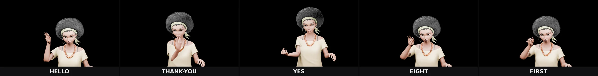

# Animation clips

Short looping clips of the Fiona rig, rendered headless in
Blender 5.2.3 and hosted on S3 (binaries live outside git — see
the asset pipeline rule in the private build repo).

Base URL: `https://bryanchasko-amazon-sumerian-hosts-asl-webp.s3.us-east-2.amazonaws.com/webp/`

## THANK-YOU movement (48 frames, 24 fps)

Fingertips at the chin, forward-down arc, palm-down end hold:


Made with:

```bash
blender -b --factory-startup --python-exit-code 1 \
  -P scripts/blender/render_host_shots.py -- \
  --out-dir out --shot sign-thank-you-move --rig fiona
```

Then downscaled to 480px and encoded to looping webp.
Sidecar (frames, fps, bytes):
[`plays/fiona-thank-you-move.sidecar.json`](https://bryanchasko-amazon-sumerian-hosts-asl-webp.s3.us-east-2.amazonaws.com/plays/fiona-thank-you-move.sidecar.json)

## Posture transition (51 frames, 12 fps)

Rest → neutral → active → neutral → rest, the between-signs
stance flow:


Made with:

```bash
blender -b --factory-startup --python-exit-code 1 \
  -P scripts/blender/render_host_shots.py -- \
  --out-dir out --shot posture-transition --rig fiona
```

Sidecar:
[`plays/fiona-posture-transition.sidecar.json`](https://bryanchasko-amazon-sumerian-hosts-asl-webp.s3.us-east-2.amazonaws.com/plays/fiona-posture-transition.sidecar.json)

## HELLO movement (48 frames, 24 fps)

B salute beside the forehead, shoulder-abduction travel:


Made with `--shot sign-hello-move --rig fiona`.
Sidecar:
[`plays/fiona-hello-move.sidecar.json`](https://bryanchasko-amazon-sumerian-hosts-asl-webp.s3.us-east-2.amazonaws.com/plays/fiona-hello-move.sidecar.json)

## YES movement (48 frames, 24 fps)

S fist nods at the chest:


Made with `--shot sign-yes-move --rig fiona`.
Sidecar:
[`plays/fiona-yes-move.sidecar.json`](https://bryanchasko-amazon-sumerian-hosts-asl-webp.s3.us-east-2.amazonaws.com/plays/fiona-yes-move.sidecar.json)

## EIGHT movement (48 frames, 24 fps)

Index up, middle-to-thumb circle, ring and pinky extended:


Made with `--shot sign-eight-move --rig fiona`.
Sidecar:
[`plays/fiona-eight-move.sidecar.json`](https://bryanchasko-amazon-sumerian-hosts-asl-webp.s3.us-east-2.amazonaws.com/plays/fiona-eight-move.sidecar.json)

## FIRST movement (48 frames, 24 fps)

Index up, palm forward, shoulder travel:


Made with `--shot sign-first-move --rig fiona`.
Sidecar:
[`plays/fiona-first-move.sidecar.json`](https://bryanchasko-amazon-sumerian-hosts-asl-webp.s3.us-east-2.amazonaws.com/plays/fiona-first-move.sidecar.json)

## Labeled strip (five rig stills, one image)

Built with Python Pillow (DejaVu Sans Bold labels on a dark
bar), committed as webp:



## Live site capture (headless Chromium, S3-hosted)

The README header shows the real page. Capture it again with:

```bash
chromium-browser --headless --disable-gpu --no-sandbox \
  --window-size=1280,800 --virtual-time-budget=20000 \
  --screenshot=signing-hosts.png \
  "https://bryanchasko.com/signing-hosts/?host=fiona&shot=signing"
ffmpeg -y -i signing-hosts.png -q:v 85 signing-hosts-live.webp
aws s3 cp signing-hosts-live.webp \
  s3://bryanchasko-amazon-sumerian-hosts-asl-webp/webp/signing-hosts-live.webp
```


