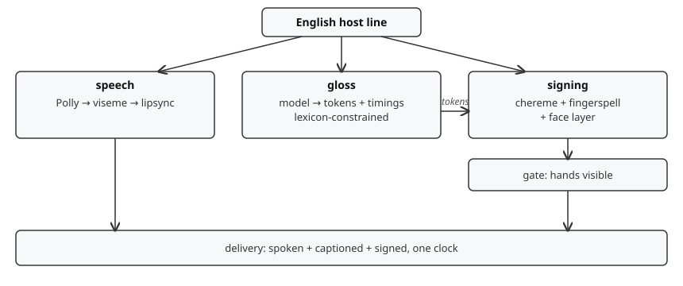

# Architecture

## Pipeline

Signing mirrors speech: one host line, spoken, captioned, and signed.



```
line (text, host, voice)
  |
  |-- speech:  Polly (banked) -> viseme weights (WebAssembly (Wasm)) -> lipsync
  |
  |-- gloss:   ASL Gloss provider (hand-authored or any compatible model)
  |              -> ASL Gloss tokens + timings
  |              constrained to data/lexicon (ai-reviewed signs only)
  |              out-of-lexicon -> fingerspell token sequence
  |
  |-- signing: chereme clip per ASL Gloss token (one clip per sign)
                 + fingerspelling poses (26 letters, A–Z)
                 + face layer (brows, mouth morphemes, additive)
                 + transitions (in / hold / out, from gesture.json model)
              -> Babylon.js animation groups on the host skeleton
  |
  `-- quality assurance (QA): segmentation model (default
               MediaPipe HandLandmarker + FaceLandmarker,
               CPU-runnable) segments hands/face in rendered
               frames; clip fails QA if hands are occluded or off-frame
```

## Host adapter contracts (sibling runtime)

The sibling `sumerian-hosts` runtime stays outside this repo. This repo
consumes its patterns without forking it: `loadHost` plus
`mergeAnimationsTo` retarget, `MakeAnimationAdditive` layering,
`gesture(name, holdMs)` with `in/hold/out` queueing,
point-of-interest (POI) 3-layer gaze weights, and frozen-peak-frame
viseme weighting. Signing adds one parallel queue beside them.

`signQueue` mirrors `gestureQueue`: load clip, retarget to host
skeleton, bake additive, play `in` once, loop `hold` for `hold_ms`,
play `out` once, resolve. Input is a validated ASL Gloss sequence from
`data/examples/gloss-demo.json`. New adapter surface is
`sign(sequence)`, `availableSigns()`, plus the existing `gesture()`,
`emote()`, `availableGestures()`. One shared clock drives speech,
captions, and signs.

## Host foundations in this repo

- Hosts: animated 3D characters based on Amazon Sumerian Hosts
  (open-sourced by Amazon Web Services (AWS)), rendered in Babylon.js.
  Humanoid hosts have a full hand rig (ten fingers) and sign; any
  non-humanoid host without a hand rig does not sign. Proven on
  rocmaibox: 134-bone rig, 34 hand bones, 30 finger joints posed and
  sticking; see `decisions/0003-finger-articulation-spike.md`.
  Host meshes are not vendored here — fetch the rig per the README
  ("The rig"), then this repo builds and runs standalone.
- Animation sets per rig bucket (male / female / alien where present):
  lipsync (17 visemes), stand_idle, blink variants, emote, gesture
  (14 clips with `in/hold/out` phasing and `gesture.json` queue
  metadata), point-of-interest (POI) look-at blend targets (27).
- Speech timing metadata drives viseme application; sign timing reuses
  the same clock so speech, captions, and signs stay in sync.

## New work in this repo

1. **Chereme rigging** — finger-level articulation on the humanoid
   rigs; one clip per lexicon sign; 26 alphabet poses (A–Z).
2. **ASL Gloss service** — ASL Gloss provider (hand-authored, no model
   needed; or ollama `qwen3:8b` / `llama3.2` on rocmaibox (cached
   now), or Llama 3.1 8B Instruct self-hosted; hosted options are
   documented in CONTRIBUTING.md) converts a host line to an ASL Gloss
   sequence. Output is validated against
   `data/lexicon/lexicon.v1.json`; unknown tokens must come back as
   fingerspelling, never as an invented sign. Reference outputs live
   in `data/examples/gloss-demo.json`.
3. **Sign authoring** — clips authored in Blender against American
   Sign Language Lexicon Video Dataset (ASLLVD) citation-form
   reference (multi-angle). ComfyUI assists texture/staging work, not
   sign formation.
4. **Face layer** — brow raise on questions, headshake on
   negation, mouth morphemes where required, on an additive layer
   following the existing blink/face_idle pattern. Face clips are
   paired per ASL Gloss in the lexicon entry and degrade to neutral when
   absent.
5. **Segmentation QA (default MediaPipe HandLandmarker +
   FaceLandmarker, central processing unit (CPU)-runnable,
   Apache-2.0; swap Segment Anything Model 3 (SAM 3) open weights,
   self-hosted, SAM License — run via the `rocm/pytorch` container
   (torch 2.13.0+rocm7.14.0, GPU confirmed))**
   — segment signer hands/face in reference footage for
   timing extraction; segment rendered output to assert hand visibility
   before a clip can be marked `qa-passed`.
6. **Stage visuals (default procedural stage, no model; swap
   Stable Diffusion XL (SDXL) Base 1.0 self-hosted, Open RAIL++-M —
   ComfyUI is live with SDXL plus canny/depth/union ControlNets,
   see docs/comfyui-container-path.md)** — neutral signing-stage
   background, lighting, and contrast only. No game props.

## Procedural asset outputs

One ai-reviewed clip library feeds all outputs. Each sign ships as a
versioned animation group `GLOSS@n` with its face pairing recorded in
the lexicon. Animation and host builds consume the same groups through
the adapter. Pose photos are frozen peak frames from the same clips,
captured headless like the existing showcase harness. Large `.glb`
files and renders stay out of git per `.gitignore` and ship through
the asset pipeline.

## Two-machine validation

Macmini has no Blender and validates everything else: lexicon lint,
ASL Gloss validation against `data/examples/gloss-demo.json`, timing
monotonicity inside `duration_ms`, category-slug checks, and contract
tests. Rocmaibox owns Blender authoring from ASLLVD reference, renders,
and segmentation QA, returning `authored` or `qa-passed` per clip with
a named reason on failure. No clip reaches `ai-reviewed` without
passing `docs/ai-review.md`; approvals are recorded in the
lexicon entry.

Rocmaibox budget (probed 2026-10-22; this is the working budget, no
gating): 1x AMD RX 6700 XT 12GB (~6.7GB free), ROCm 7.2.0, 24-thread
central processing unit (CPU), 62GB RAM, 153GB disk free. Check
`ollama ps` before GPU runs (5.3GB VRAM was in use at idle). Runnable now: ollama 0.18.0 with ROCm
libraries (`qwen3:8b`, `llama3.2` cached), MediaPipe tasks on CPU,
hand-authored ASL Gloss, CPU EEVEE renders, SAM 3 via the `rocm/pytorch`
container (1 GPU visible). SDXL / ControlNet via the live ComfyUI
service (SDXL Base plus canny/depth/union ControlNets confirmed
2026-10-23). Blender GPU render unconfirmed (CPU-only enumeration).
Renders in this repo are CPU renders. Environment truth comes from
checking live services, not just one user's containers: ComfyUI
answers on its port with SDXL and ControlNet models loaded, and a
`blender-mcp-http` Blender MCP server runs on port 8190 — verified
2026-10-23: server v1.29.1, live Blender 5.1.2, 26 tools including
arbitrary Python exec, viewport render, and screenshots.

## Fallback (decided, not improvised)

If finger articulation cannot hit review quality by the Phase 1
spike (see roadmap), the build ships a synced signing inset —
licensed signer video driven by the same ASL Gloss tokens — while
chereme work continues. The ASL Gloss service, lexicon, and QA contracts are identical
in both modes. See `docs/decisions/0002-signing-inset-fallback.md`.

## Out of scope

- Open-domain English-to-ASL translation.
- Lengua de Señas Mexicana (LSM) — second language after American
  Sign Language (ASL) ships.
- Sign-to-speech / sign recognition input (bidirectional). Partner
  Software Development Kit (SDK) territory (e.g. Sign-Speak); this
  repo is output only.
- Signing for any host without a hand rig.

## Domain-jargon note

Hosts translate general dialogue English. They do not attempt specialist
registers (aerospace, NFL) — though everyday cloud/AI vocabulary
(cloud, data, computer, internet, learn) is in the seed lexicon,
with AWS, AI, and app names fingerspelled.
