# Signing cookbook: poses for Sumerian hosts

Each still lists joint values, code, and reference link. All
angles are drafts until they pass [ai-review.md](ai-review.md).

Reference images from American Sign Language Lexicon Video Dataset
(ASLLVD) are linked from each pose section. Every section links
its fetched citation (Lifeprint lesson or SignBank variant).

## How to read a pose

Finger flexion is one number per joint, applied as an Euler rotation
`(0, 0, -v)` on the joint's local Z axis. `0.0` is extended,
`1.0` is full flex. Negative Z curls toward the palm; the local X
axis is the bone roll axis and barely moves the fingertip — except
on the thumb base, which needs off-axis terms (see F and 3): a
joint written as an explicit `(x, y, z)` triple is applied
verbatim instead of `(0, 0, -v)`. Same values on both hands come
out mirror-symmetric because the rig is mirrored.

```python
specs += [("char:def_r_fngIndexA", (0, 0, -v))]  # v per table below
# explicit form, thumb base only:
specs += [("char:def_r_fngThumbA", (0.35, 0, -0.05))]
```

Close-ups render under one of two chereme presets (`CHEREMES`
in both posing scripts, identical dicts; `--chereme` /
`CHEREME` selects, numbers default `cardinal_numeral`, letters
default `letter_or_digit`).

| Preset             | Palm side        | Shoulders       | Elbows            | Wrist                                 | Camera                                   |
| ------------------ | ---------------- | --------------- | ----------------- | ------------------------------------- | ---------------------------------------- |
| `letter_or_digit`  | palm-out         | (0, -0.8, 0.15) | (0, -0.7, 0.0)    | roll 0.0, flexion 0.0                 | palm-frame, lens 110 front / 150 profile |
| `cardinal_numeral` | palm-in (dorsal) | (0, -0.4, -0.2) | (-2.5, -0.5, 0.0) | roll 0.0, flexion -1.0, deviation 0.1 | palm-frame, lens 110 front / 150 profile |

Letters cite palm-out on the
presentation-arms baseline (shoulders `(0, -0.8, 0.15)`, elbows
`(0, -0.7, 0.0)`: the hand floats ~29cm forward of the chest so
sightlines clear the body; rest arms park the hand where the
torso fills profile frames) with a neutral wrist (roll 0.0 about
the true X twist axis, flexion 0.0). Cardinal numerals 1–5 cite
palm-in — isolated 1–5 are palm-back (Vicars; the addressee
sees the dorsal side): shoulders `(0, -0.4, -0.2)`, elbows
`(-2.5, -0.5, 0.0)`, wrist roll 0.0 (ZERO twist), flexion -1.0,
deviation 0.1. Pronation lives at the elbow (X roll is rigid
distal rotation: no mesh deformation) and the wrist only bends:
a 2.79 wrist-twist trial knotted the wrist mesh into a visible
pinch/fold and was reverted the same day — the big rotation
never goes back on the wrist. The pose stages naturally first
(elbow tucked at the ribs, hand in chest signing space,
verified on wide side + front witnesses) and the CAMERA does
the framing work: cardinal fronts shoot 10deg medial-of-
straight so the tucked elbow hides behind the hand mass and
the shoulder falls past the frame edge (dorsal still
dominates). Never compromise the anatomy to satisfy a crop
box. Measured against Vicars number03 ground truth
(frontality −0.94, knuckles out, thumb frame-left, smooth
wrist). Right side only with the left arm parked behind the
back. True axis map,
measured by single-axis probes: shoulder X = axial twist, Y- =
forward flexion, Z+ = abduction; elbow Y- = flexion. Soft
neutral light (big frontal key + fill, gentle rim), lens 110
front / 150 profile, 1.4 m (`PALM_DIST`). Hands present in
signing space, never dangling at the hip; each shape carries an
in-situ torso render as its location witness.

Reference stills `ref-*.png`: cropped Documentation MP4 frames
from the Sign-Language-Mocap-Archive (Studio Galt, CC0-1.0,
license verified via GitHub API 2026-10-24), entries under
`SG ASL Fingerspelling/Letters` and `/Numbers`. The only
reference pixels this repo may embed (ASLLVD frames stay
link-only per dataset terms). Source clips live outside the
repo (`~/mcap-ref/*.mp4` on rocmaibox); crops re-cut 2026-10-24
so every still shows the complete hand (the first A/F/1 crops
cut the fingers out of frame).

Reference landmark signatures (MediaPipe HandLandmarker,
`scripts/qa/compare_landmarks.py`; extension ≥ 1.4 counts as
extended, distances normalized by wrist-to-middle-knuckle):

| Ref | Extended set            | Signature detail                |
| --- | ----------------------- | ------------------------------- |
| A   | none (fist)             | digits together, spread 0.11    |
| B   | index+middle+ring+pinky | thumb tucked 0.87               |
| F   | middle+ring+pinky       | thumb+index in circle, gap 0.18 |
| 1   | index                   | index 2.02, rest tucked         |
| 2   | index+middle+thumb      | thumb 1.42 splayed in the crop  |
| 3   | index+middle+thumb      | ring/pinky tucked               |
| 4   | index+middle+ring+pinky | thumb tucked 1.01               |
| 5   | all five                | spread 0.45                     |

Every set equals its citation formation except 2, whose crop
splays the thumb (1.42, reads extended). The probe certifies
references; our textureless renders fall outside the
detector's photo domain, so renders are certified by bone
measurement plus the side-by-side panels in each section.
The number refs depict palm-out series-form hands while our
cardinal stills cite dorsal: extended SETS still compare, but
thumb/pinky x-order mirrors (see `check_chirality.py`).

Camera aim for close-ups: `target = wrist + 0.55 * (midC_head - wrist)`,
camera on the palm normal 1.4 m out (`PALM_DIST`), finger
direction mapped to frame-up — using joint heads only. Def-bone
tails sit meters from their heads on this rig and must not be
used for aiming. A fixed-viewpoint trial (2026-10-24, identical
camera for all poses) clipped fingertips and sprawled the
forearm, so per-pose derivation stays: identical lens,
distance, and chereme stance keep the set comparable while each
plate stays readable. Profiles orbit 90deg about the finger
direction (leveled, outward from the midline, lens 150;
cardinals bias the orbit toward the back so the sightline
drifts forward of the face, letters ~8deg look-down).

## A — fist, thumb alongside

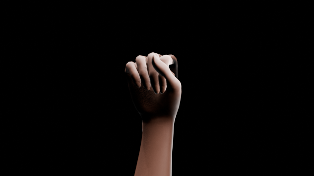
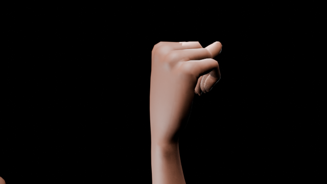
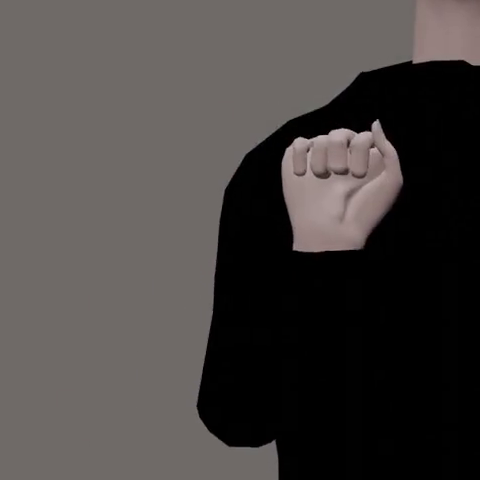


| Finger | A    | B   | C    |
| ------ | ---- | --- | ---- |
| Thumb  | 0.35 | 0.2 | 0.15 |
| Index  | 1.0  | 1.0 | 0.8  |
| Middle | 1.0  | 1.0 | 0.8  |
| Ring   | 1.0  | 1.0 | 0.8  |
| Pinky  | 1.0  | 1.0 | 0.8  |

```python
"a": {"fngThumb": (0.35, 0.2, 0.15), "fngIndex": (1.0, 1.0, 0.8),
      "fngMid": (1.0, 1.0, 0.8), "fngRing": (1.0, 1.0, 0.8),
      "fngPinky": (1.0, 1.0, 0.8)}
```

Wrist/camera: `letter_or_digit` preset — shoulders (0, -0.8, 0.15), elbows (0, -0.7, 0.0), wrist neutral (roll 0.0, flexion 0.0, palm-side), right side only. Palm-frame camera, soft neutral light, lens 110 front / 150 profile; in-situ witness below.

Reference: [Lifeprint A](https://www.lifeprint.com/asl101/pages-signs/a/a.htm)
(alphabet chart: [A handshape](https://www.lifeprint.com/asl101/fingerspelling/abc.htm)).
Citation formation: closed fist, thumb alongside — matches
ref-a.png below.
Formation (ADR 0003 draft): fist, thumb alongside.

Compare: front still shows a fully closed fist, no extended
digits, thumb up alongside on the radial side; profile shows
the thumb pressed along the fist with no ring daylight (the
2026-10-24 profile read as an F/OK ring — scorecard FLAG, fixed
by raising thumb curl 0.2/0.1/0.1 to 0.35/0.2/0.15; 0.5+ wraps
into S territory). Framing is palm-side under the neutral
baseline. Detector MATCH on our render (fist, none extended);
chirality MATCH vs reference.

AI-review: `ai-reviewed` 2026-10-29 (1 citation Lifeprint A
chart PASS; 2 code-match PASS; 3 own camera lines; 4 no outside
media; 5 probes PASS — index-only and middle-only extend the
anatomically correct digit; 6 PASS by eye — closed fist, no
extended digits, thumb alongside, palm-side framing, chirality
MATCH vs reference). Detector MATCH on our render (fist, none
extended). Open: thumb-lay nuance.

## B — flat hand

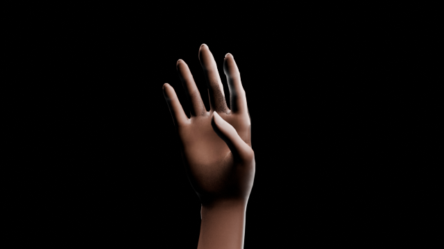
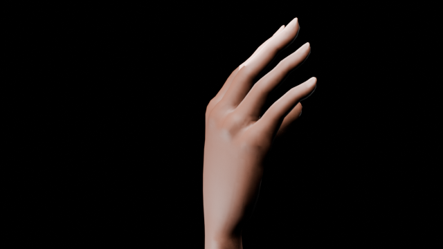
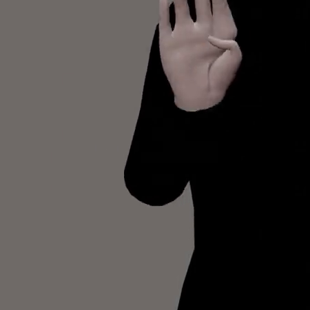
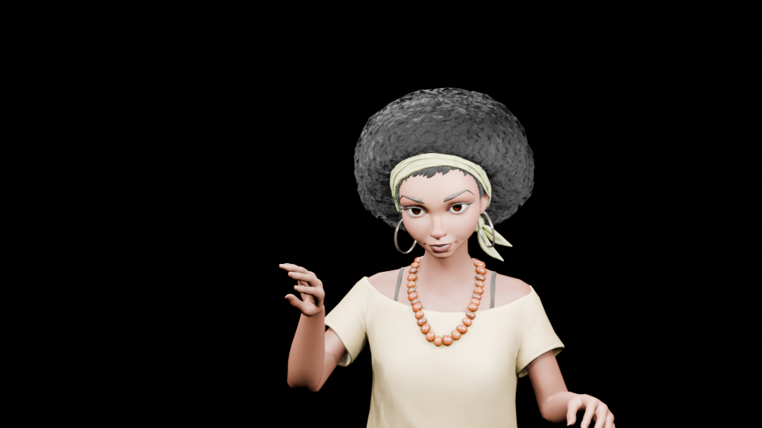

| Finger | A    | B    | C    |
| ------ | ---- | ---- | ---- |
| Thumb  | 0.4  | 0.2  | 0.1  |
| Index  | 0.05 | 0.05 | 0.05 |
| Middle | 0.05 | 0.05 | 0.05 |
| Ring   | 0.05 | 0.05 | 0.05 |
| Pinky  | 0.05 | 0.05 | 0.05 |

```python
"b": {"fngThumb": (0.4, 0.2, 0.1), "fngIndex": (0.05, 0.05, 0.05),
      "fngMid": (0.05, 0.05, 0.05), "fngRing": (0.05, 0.05, 0.05),
      "fngPinky": (0.05, 0.05, 0.05)}
```

Wrist/camera: `letter_or_digit` preset — shoulders (0, -0.8, 0.15), elbows (0, -0.7, 0.0), wrist neutral (roll 0.0, flexion 0.0, palm-side), right side only. Palm-frame camera, soft neutral light, lens 110 front / 150 profile; in-situ witness below.

Reference: [Lifeprint B](https://www.lifeprint.com/asl101/pages-signs/b/b.htm)
("Version 1" general form: thumb with a slight bend, alongside).
Citation formation: flat hand, fingers together, thumb alongside —
matches ref-b.png below.
Formation (ADR 0003 draft): flat hand.

Compare: palm still shows four fingers up, parallel (spread
unarticulated — open), thumb at mid height on the radial side;
profile shows a flat plane, no curl. Thumb lay: alongside as
rendered — the across-palm variant is not confirmed (open).

AI-review: `ai-reviewed` (shape) 2026-10-24; citation Lifeprint B
(check 1 PASS), thumb-across open. Still re-verified 2026-10-29
under the neutral baseline; detector MATCH on our render (4
extended).

## F — thumb-index circle

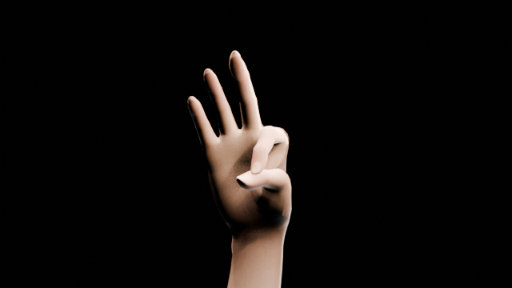
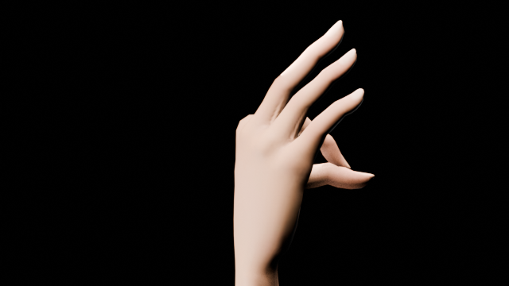
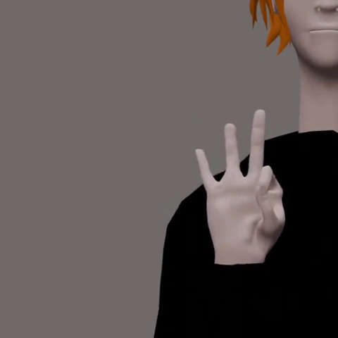
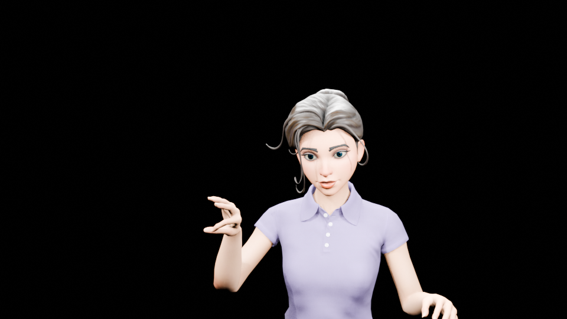

| Finger | A                        | B    | C    |
| ------ | ------------------------ | ---- | ---- |
| Thumb  | (-0.9, 0, -0.5) explicit | 0.5  | 0.3  |
| Index  | (0, 0, -0.9) explicit    | 0.6  | 0.4  |
| Middle | 0.05                     | 0.05 | 0.05 |
| Ring   | 0.05                     | 0.05 | 0.05 |
| Pinky  | 0.05                     | 0.05 | 0.05 |

```python
"f": {"fngThumb": ((-0.9, 0.0, -0.5), 0.5, 0.3),
      "fngIndex": ((0.0, 0.0, -0.9), 0.6, 0.4),
      "fngMid": (0.05, 0.05, 0.05), "fngRing": (0.05, 0.05, 0.05),
      "fngPinky": (0.05, 0.05, 0.05)}
```

Wrist/camera: `letter_or_digit` preset — shoulders (0, -0.8, 0.15), elbows (0, -0.7, 0.0), wrist neutral (roll 0.0, flexion 0.0, palm-side), right side only. Palm-frame camera, soft neutral light, lens 110 front / 150 profile; in-situ witness below.

Reference: [Lifeprint F](https://www.lifeprint.com/asl101/pages-signs/f/f.htm)
(thumb-index circle, letter form — no tap). Citation formation:
thumb-index circle, rest extended — matches ref-f.png below.
Formation (ADR 0003 draft): thumb-index circle, others extended.

Circle verdict (2026-10-24): bone-tip measurement drove the
thumb-index gap 44.8 → 11.7 mm via decoupled thumb/index A
values (uniform deeper curl made it worse at 61.8 — contact
needs per-joint solving, not more curl); values updated above.
Confirmed three ways: palm still shows the ring aperture, the
profile shows a closed loop, and 11.7 mm is within summed finger
radii (surfaces touching). The idle re-render shows the ring
face-on. Compare against the CC0 reference still above.

AI-review: `ai-reviewed` (shape) 2026-10-24; citation Lifeprint F
(check 1 PASS), spread open. Still re-verified 2026-10-29 under
the neutral baseline; detector MATCH on our render (ring gap
0.19).

## 1 — index up, rest tucked

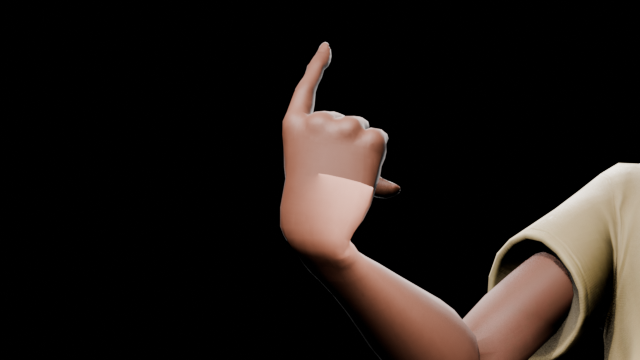
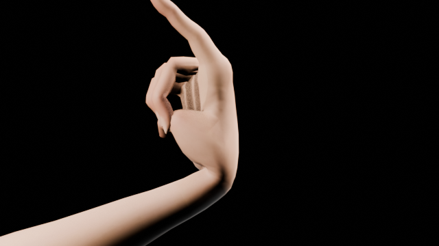
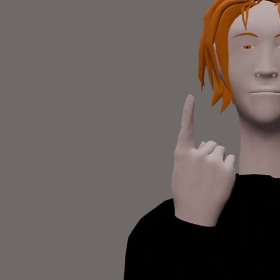


| Finger | A    | B    | C    |
| ------ | ---- | ---- | ---- |
| Thumb  | 0.9  | 0.7  | 0.5  |
| Index  | 0.05 | 0.05 | 0.05 |
| Middle | 1.0  | 1.0  | 0.8  |
| Ring   | 1.0  | 1.0  | 0.8  |
| Pinky  | 1.0  | 1.0  | 0.8  |

```python
"n1": {"fngThumb": (0.9, 0.7, 0.5), "fngIndex": (0.05, 0.05, 0.05),
       "fngMid": (1.0, 1.0, 0.8), "fngRing": (1.0, 1.0, 0.8),
       "fngPinky": (1.0, 1.0, 0.8)}
```

Wrist/camera: `cardinal_numeral` preset — shoulders (0, -0.4, -0.2), elbows (-2.5, -0.5, 0.0), wrist roll 0.0, flexion -1.0, deviation 0.1, dorsal-side, right side only. Palm-frame camera, soft neutral light, lens 110 front / 150 profile; in-situ witness below.

Reference: [SignBank ONE](https://dai.cs.rutgers.edu/dai/s/translation?id=2105)
(variant 2105). Citation formation: "Index finger extends upward
with palm back — dorsal side, knuckles and nails to the addressee —
and remaining fingers closed" (orientation per the Vicars
isolated-1–5 palm-back rule; SignBank is the lexical reference).

Compare: one extended digit up, fist mass below, thumb tucked.
Isolation probe shows the extended digit is the index. Check all
three against the pixels. The reference lays its thumb across
the front of the curled fingers; ours tucks alongside — thumb
lay stays open.

AI-review: `ai-reviewed` 2026-10-24 (checks 1–6 pass; spread
n/a, thumb lay open). Still re-rendered and re-verified
2026-10-29 under the cardinal (dorsal) citation. Detector:
MATCH extended-set=index on our render (index 1.76; thumb
0.95 correctly unextended); chirality asserts detection only
(the tucked tip flips x-order across poses, so no order is
asserted). Eye-verified index-only correct.

## 5 — open hand

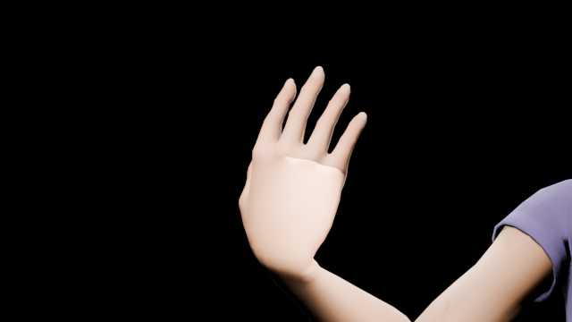
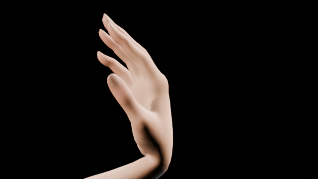
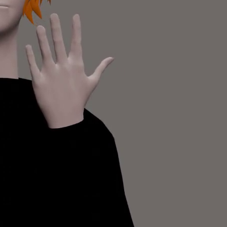


| Finger | A    | B    | C    |
| ------ | ---- | ---- | ---- |
| Thumb  | 0.05 | 0.05 | 0.05 |
| Index  | 0.05 | 0.05 | 0.05 |
| Middle | 0.05 | 0.05 | 0.05 |
| Ring   | 0.05 | 0.05 | 0.05 |
| Pinky  | 0.05 | 0.05 | 0.05 |

```python
"n5": {"fngThumb": (0.05, 0.05, 0.05), "fngIndex": (0.05, 0.05, 0.05),
       "fngMid": (0.05, 0.05, 0.05), "fngRing": (0.05, 0.05, 0.05),
       "fngPinky": (0.05, 0.05, 0.05)}
```

Wrist/camera: `cardinal_numeral` preset — shoulders (0, -0.4, -0.2), elbows (-2.5, -0.5, 0.0), wrist roll 0.0, flexion -1.0, deviation 0.1, dorsal-side, right side only. Palm-frame camera, soft neutral light, lens 110 front / 150 profile; in-situ witness below.

Reference: [SignBank FIVE](https://dai.cs.rutgers.edu/dai/s/translation?id=1243)
(variant 1243). Citation formation: "All five digits spread wide
with palm back — dorsal side to the addressee" (orientation per
the Vicars isolated-1–5 palm-back rule; SignBank is the lexical
reference).

Compare: four fingers plus thumb out, dorsal side visible with
nails up, clearly distinct from B (thumb out vs alongside).
Spread: citation says wide, render shows parallel digits — open.

AI-review: `ai-reviewed` 2026-10-24 (checks 1–6 pass; spread
open, thumb lay open). Still re-rendered and re-verified
2026-10-29 under the cardinal (dorsal) citation; detector reads
4 of 5 (thumb 1.03, foreshortened in dorsal projection under
the 1.40 palm-calibrated threshold — visibly extended,
eye-verified).

## 2 — index and middle extended

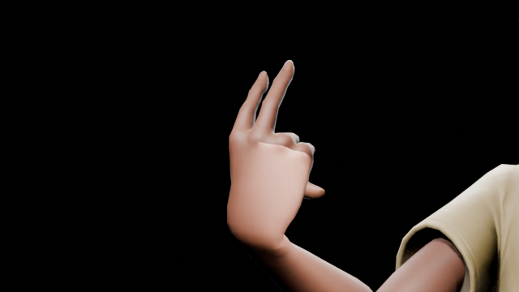
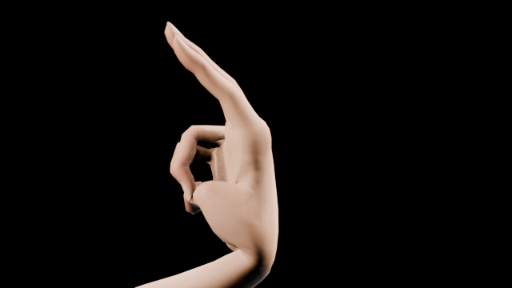
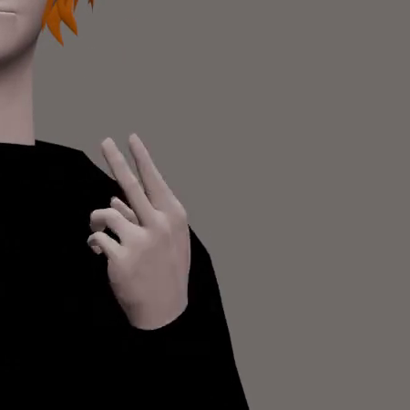
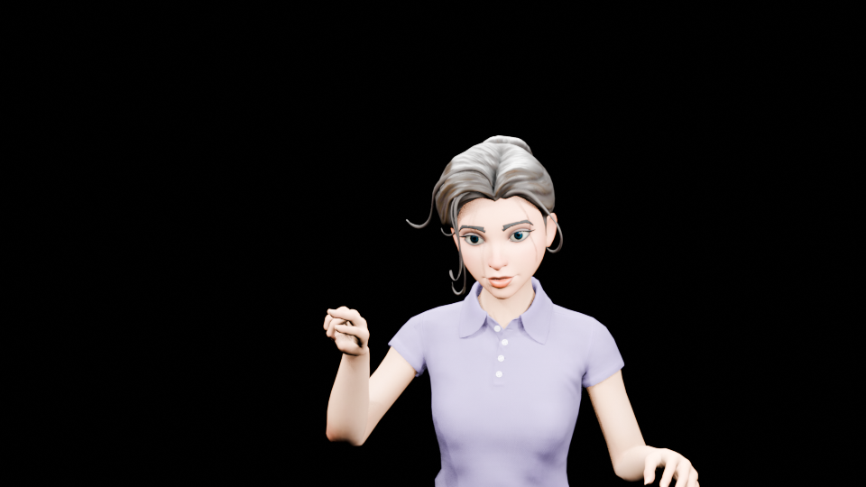

| Finger | A    | B    | C    |
| ------ | ---- | ---- | ---- |
| Thumb  | 0.9  | 0.7  | 0.5  |
| Index  | 0.05 | 0.05 | 0.05 |
| Middle | 0.05 | 0.05 | 0.05 |
| Ring   | 1.0  | 1.0  | 0.8  |
| Pinky  | 1.0  | 1.0  | 0.8  |

```python
"n2": {"fngThumb": (0.9, 0.7, 0.5), "fngIndex": (0.05, 0.05, 0.05),
       "fngMid": (0.05, 0.05, 0.05), "fngRing": (1.0, 1.0, 0.8),
       "fngPinky": (1.0, 1.0, 0.8)}
```

Wrist/camera: `cardinal_numeral` preset — shoulders (0, -0.4, -0.2), elbows (-2.5, -0.5, 0.0), wrist roll 0.0, flexion -1.0, deviation 0.1, dorsal-side, right side only. Number-shot camera (palm normal 1.4 m out, finger direction to frame-up), lens 110 front / 150 profile; in-situ witness below.

Proof (2026-10-24, one pose before any batch): index-only and
middle-only isolation renders show the correct digits extend while
the rest tuck into a fist, so `fngIndex`/`fngMid` name the right
bones. The still above shows two extended fingers up, parallel
(spread unarticulated — open), ring/pinky tucked, thumb tucked
alongside — not touching the index. Reference:
[SignBank TWO](https://dai.cs.rutgers.edu/dai/s/translation?id=2933)
(variant 2933; page verified live: "Related English Words for
Sign Variant: TWO"). Still open, stated plainly: thumb lay and
spread are authoring conventions, and clips ship at
`ai-reviewed`.
Reproduce on rocmaibox with `--shot number-2` (chereme preset
`cardinal_numeral` is the default; `--chereme letter_or_digit`
renders the palm-out digit-string inflection; see "Reproducing
any pose" below).

Citation formation: "Index and middle fingers extend upward in
a V with palm back — dorsal side to the addressee" (orientation
per the Vicars isolated-1–5 palm-back rule; SignBank 2933 is
the lexical reference). Compare: two digits up, tucked mass
below the knuckle line, thumb clear of the index — the V
spread itself unarticulated (open).

AI-review: `ai-reviewed` 2026-10-24 (checks 1–6 pass; spread
and thumb lay open). Still re-rendered and re-verified
2026-10-29 under the cardinal (dorsal) citation. Detector
reads index+middle on our render (thumb 1.02, correctly
unextended — tucked alongside per the dict; the ref's splayed
thumb is a crop-side quirk, not our defect); chirality
mirrored PASS. (An earlier staging was detector-blind on n2;
the check carries blind-tolerant handling for that case.)

## 3 — thumb, index, middle extended

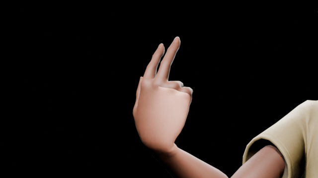
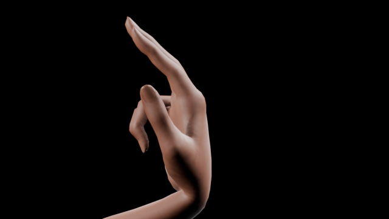
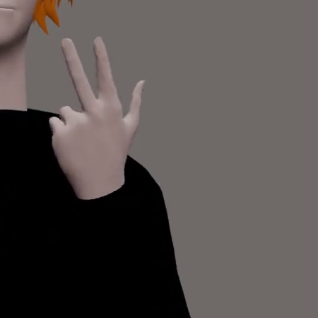


| Finger | A                         | B    | C    |
| ------ | ------------------------- | ---- | ---- |
| Thumb  | (0.35, 0, -0.05) explicit | 0.05 | 0.05 |
| Index  | 0.05                      | 0.05 | 0.05 |
| Middle | 0.05                      | 0.05 | 0.05 |
| Ring   | 1.0                       | 1.0  | 0.8  |
| Pinky  | 1.0                       | 1.0  | 0.8  |

```python
"n3": {"fngThumb": ((0.35, 0.0, -0.05), 0.05, 0.05),
       "fngIndex": (0.05, 0.05, 0.05),
       "fngMid": (0.05, 0.05, 0.05), "fngRing": (1.0, 1.0, 0.8),
       "fngPinky": (1.0, 1.0, 0.8)}
```

Wrist/camera: `cardinal_numeral` preset — shoulders (0, -0.4, -0.2), elbows (-2.5, -0.5, 0.0), wrist roll 0.0, flexion -1.0, deviation 0.1, dorsal-side, right side only. Number-shot camera (palm normal 1.4 m out, finger direction to frame-up), lens 110 front / 150 profile; in-situ witness below.

Thumb verdict (2026-10-29): the 2026-10-24 Y+0.5 fix never
showed in pixels — the still read two digits (scorecard FLAG).
Thumb-base X abducts the thumb on this rig (F uses X-0.9 to
swing toward the index); X+0.25 with B/C near-extended splays
the thumb lateral, matching the reference; re-tuned to X+0.35
under the neutral-wrist baseline. Confirmed by eye: thumb,
index, and middle distinctly countable, ring and pinky tucked,
dorsal side to camera (knuckles, nail plates), fingers up.

AI-review: `ai-reviewed` 2026-10-29 (sixth pass: full tuck,
medial camera, relaxed wrist — 1 URL live; 2 code-match PASS;
3 own chereme/camera lines; 4 no outside media; 5 probes PASS;
6 PASS by eye — three countable digits, ring/pinky tucked,
dorsal side, fingers up, smooth wrist, natural arm on the wide
witness, verified against Vicars number03 ground truth:
knuckles out, thumb frame-left).
Detector advisory: reads index+middle on our render (thumb
1.15, foreshortened in dorsal projection under the 1.40
palm-calibrated threshold — visibly extended, eye-verified).
Open: spread, thumb-lay nuance.

Reference: [SignBank THREE](https://dai.cs.rutgers.edu/dai/s/translation?id=2834)
(variant 2834). Citation formation: "Thumb, index, and middle
fingers extend with palm back — dorsal side to the addressee"
(orientation per the Vicars isolated-1–5 palm-back rule;
SignBank is the lexical reference).

## 4 — four fingers extended, thumb tucked

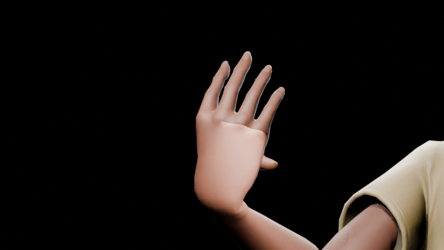
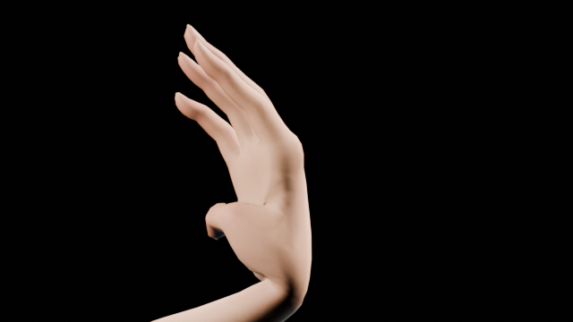
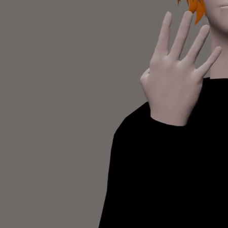
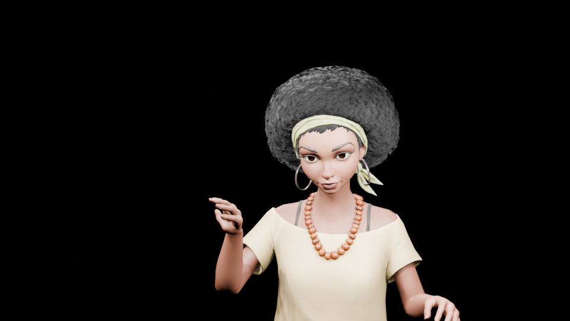

| Finger | A    | B    | C    |
| ------ | ---- | ---- | ---- |
| Thumb  | 0.9  | 0.7  | 0.5  |
| Index  | 0.05 | 0.05 | 0.05 |
| Middle | 0.05 | 0.05 | 0.05 |
| Ring   | 0.05 | 0.05 | 0.05 |
| Pinky  | 0.05 | 0.05 | 0.05 |

```python
"n4": {"fngThumb": (0.9, 0.7, 0.5), "fngIndex": (0.05, 0.05, 0.05),
       "fngMid": (0.05, 0.05, 0.05), "fngRing": (0.05, 0.05, 0.05),
       "fngPinky": (0.05, 0.05, 0.05)}
```

Wrist/camera: `cardinal_numeral` preset — shoulders (0, -0.4, -0.2), elbows (-2.5, -0.5, 0.0), wrist roll 0.0, flexion -1.0, deviation 0.1, dorsal-side, right side only. Number-shot camera (palm normal 1.4 m out, finger direction to frame-up), lens 110 front / 150 profile; in-situ witness below.

Proof (2026-10-24): four extended digits countable with
anatomical length grading (index, middle, ring, pinky), thumb
tucked alongside. Reference live (variant 1301). Citation
formation: "Four fingers extend upward with thumb tucked and
palm back — dorsal side to the addressee" (orientation per the
Vicars isolated-1–5 palm-back rule; SignBank is the lexical
reference) — compare each clause against the still.

AI-review: `ai-reviewed` 2026-10-24 (checks 1–6 pass; spread
and thumb lay open). Still re-rendered and re-verified
2026-10-29 under the cardinal (dorsal) citation. Detector: 4
extended digits MATCH, tucked thumb 1.11 (correctly
unextended, no advisory).

Reference: [SignBank FOUR](https://dai.cs.rutgers.edu/dai/s/translation?id=1301)
(variant 1301). Citation: palm back, dorsal to the addressee.

## 6

Index, middle, and ring up; pinky folded to the thumb, palm out.

Reference: https://www.lifeprint.com/asl101/pages-signs/n/numbers1-10.htm

```python
"n6": {"fngThumb": ((0.3, 0.0, -0.2), 0.5, 0.4),
       "fngIndex": (0.05, 0.05, 0.05),
       "fngMid": (0.05, 0.05, 0.05),
       "fngRing": (0.05, 0.05, 0.05),
       "fngPinky": (0.7, 0.6, 0.5)},
```

Wrist: flexion arm, palm-forward, near-straight wrist; the 6-9
family stages high (face height) with the palm to the addressee.
Camera: 110mm telephoto close-up plus torso witness.

## 7

Pinky, middle, and index up; ring folded to the thumb, palm out.

Reference: https://www.lifeprint.com/asl101/pages-signs/n/numbers1-10.htm

Reference: https://dai.cs.rutgers.edu/dai/s/occurrence?id_SignBankVariant=2504

```python
"n7": {"fngThumb": ((0.3, 0.0, -0.2), 0.5, 0.4),
       "fngIndex": (0.05, 0.05, 0.05),
       "fngMid": (0.05, 0.05, 0.05),
       "fngRing": (0.8, 0.7, 0.6),
       "fngPinky": (0.05, 0.05, 0.05)},
```

Wrist: flexion arm, palm-forward, near-straight wrist; staged high
with the palm to the addressee. Camera: 110mm telephoto close-up
plus torso witness.

## 8

Index, ring, and pinky up; middle folded to the thumb, palm out.

Reference: https://www.lifeprint.com/asl101/pages-signs/n/numbers1-10.htm

Reference: https://dai.cs.rutgers.edu/dai/s/occurrence?id_SignBankVariant=1077

```python
"n8": {"fngThumb": ((0.3, 0.0, -0.2), 0.5, 0.4),
       "fngIndex": (0.05, 0.05, 0.05),
       "fngMid": (0.8, 0.7, 0.6),
       "fngRing": (0.05, 0.05, 0.05),
       "fngPinky": (0.05, 0.05, 0.05)},
```

Wrist: flexion arm, palm-forward, near-straight wrist; staged high
with the palm to the addressee. Camera: 110mm telephoto close-up
plus torso witness.

## 9

Thumb-index circle with middle, ring, and pinky up, palm out
(ASLLVD labels this token F; the circle matches while the three
fingers stay extended, unlike the fingerspelled F).

Reference: https://www.lifeprint.com/asl101/pages-signs/n/numbers1-10.htm

Reference: https://dai.cs.rutgers.edu/dai/s/occurrence?id_SignBankVariant=1915

```python
"n9": {"fngThumb": ((-0.7, 0.0, -0.4), 0.5, 0.3),
       "fngIndex": ((0.0, -0.1, -0.8), 0.5, 0.3),
       "fngMid": (0.05, 0.05, 0.05),
       "fngRing": (0.05, 0.05, 0.05),
       "fngPinky": (0.05, 0.05, 0.05)},
```

Wrist: flexion arm, palm-forward, near-straight wrist; staged high
with the palm to the addressee. Camera: 110mm telephoto close-up
plus torso witness.

## P1

Point hand (Batch-5 pronoun/wh-signs ME/YOU/THIS/WHERE/WHO/TRUE):
n1 index with the thumb tucked tighter against the palm. In
forward-point arms the n1 thumb reads as a dangling second digit
(side-view verified); numbers keep n1.

Reference: https://www.lifeprint.com/asl101/pages-signs/m/me.htm
Reference: https://www.lifeprint.com/asl101/pages-signs/y/you.htm
Reference: https://www.lifeprint.com/asl101/pages-signs/t/this.htm
Reference: https://www.lifeprint.com/asl101/pages-signs/w/where.htm
Reference: https://www.lifeprint.com/asl101/pages-signs/w/who.htm
Reference: https://www.lifeprint.com/asl101/pages-signs/t/true.htm

```python
"p1": {"fngThumb": (1.1, 1.0, 0.8),
       "fngIndex": (0.05, 0.05, 0.05),
       "fngMid": (1.0, 1.0, 0.8),
       "fngRing": (1.0, 1.0, 0.8),
       "fngPinky": (1.0, 1.0, 0.8)},
```

Wrist: per-sign point arm (sweep mode point: align + proximity);
YOU/WHERE forward at chest height, THIS down-forward, WHO/TRUE at
mouth height, ME deep wrist pitch to the chest. Camera: torso witness
plus side-view probe (inspect_pose) for depth.

## HELLO — flat hand beside the forehead

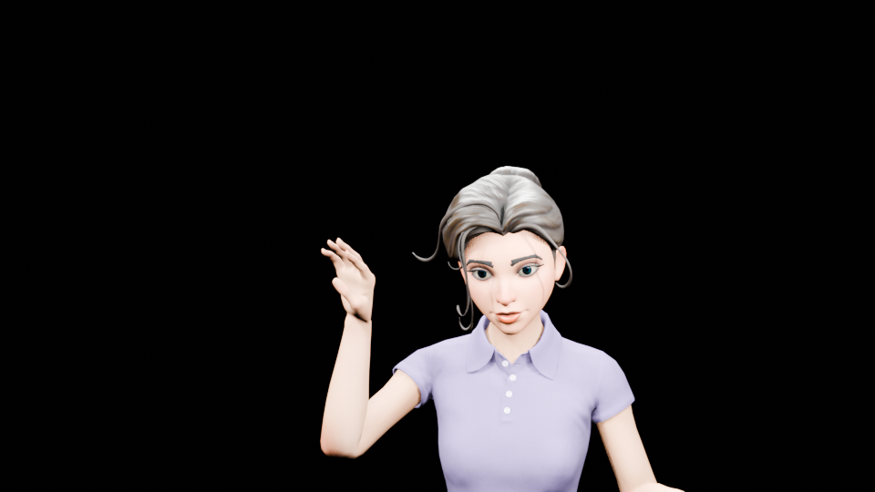

| Bone           | X                   | Y     | Z     |
| -------------- | ------------------- | ----- | ----- |
| Right shoulder | -0.4                | -0.95 | -0.15 |
| Right elbow    | 0                   | -1.5  | 0     |
| Right wrist    | 1.2                 | 0     | 0     |
| Right hand     | B handshape (see B) |       |       |

```python
"hello": {"hand": "b", "sh": (-0.4, -0.95, -0.15),
          "el": (0.0, -1.5, 0.0), "wr": (1.2, 0.0, 0.0)},
```

Citation key pose (SIGNS in render_host_shots.py): flat hand
beside the forehead, fingers up, palm out — measured wrist
(−0.254, −0.054, 1.542), frontality +0.86, fingers
(0.19, −0.22, 0.96). The sign then moves outward from the
forehead; a still certifies handshape + location + orientation
only, never movement (ai-review.md). Status: authored.

Reference: [SignBank HELLO](https://dai.cs.rutgers.edu/dai/s/translation?id=1486)
(HTTP 200, page names HELLO, verified 2026-10-30).

Wrist/camera: wrist roll 1.2 about the true X twist axis,
flexion 0, deviation 0. Camera is the torso witness: aims
between neck and raised wrist, offset `(0.35, -2.0, 0.45)`,
lens 50 — face and hand both in frame (location/tab is the
point of a sign render).

## THANK-YOU — flat hand at the chin (start pose)

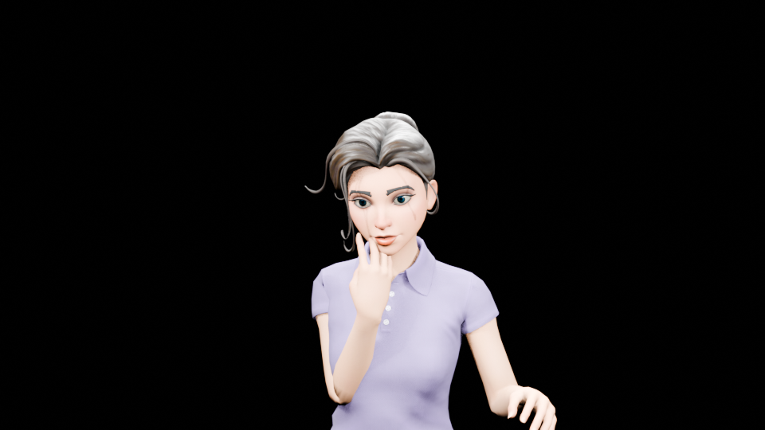

| Bone           | X                   | Y    | Z    |
| -------------- | ------------------- | ---- | ---- |
| Right shoulder | 0.2                 | -0.4 | -0.7 |
| Right elbow    | -2.2                | -1.3 | 0    |
| Right wrist    | 0                   | 0    | 0    |
| Right hand     | B handshape (see B) |      |      |

```python
"thank-you": {"hand": "b", "sh": (0.2, -0.4, -0.7),
              "el": (-2.2, -1.3, 0.0), "wr": (0.0, 0.0, 0.0)},
```

Citation start pose: flat hand at the chin, fingers up, palm
toward the signer — measured wrist (−0.018, −0.087, 1.414),
fingertip midpoint (−0.006, −0.059, 1.581) against the lips
(0, −0.056, 1.555), frontality −0.69. Palm-in comes from the
elbow roll + shoulder twist (which swings the hand to the
midline) + −0.45 wrist flexion — 1.0-rad shoulder twist was
zoom-checked for mesh pinching and ships clean. Verified
against Vicars thank-you-01 on front, side, and zoom: flat
B dez, fingertips touching the lips, dorsal to the addressee,
elbow tucked. The sign then moves forward and down away from
the chin. Status: authored.

Reference: [Lifeprint THANK-YOU](https://www.lifeprint.com/asl101/pages-signs/t/thankyou.htm)
(Lesson 01: fingertips near the lips, flat hand, forward and a bit
down). ASLLVD frames stay link-only per dataset terms.

Wrist/camera: wrist roll 0, flexion −0.45, deviation 0.
Camera is the torso witness: aims between neck and raised
wrist, offset `(0.35, -2.0, 0.45)`, lens 50.

## THANK-YOU movement — chin to forward-down (demo video)

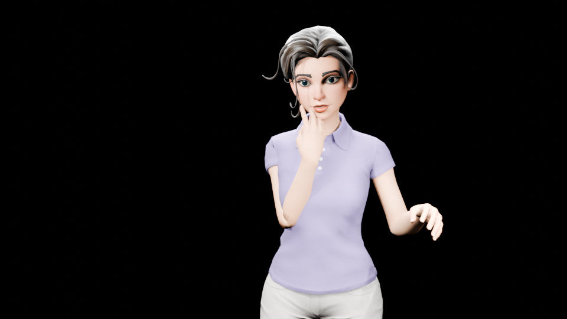
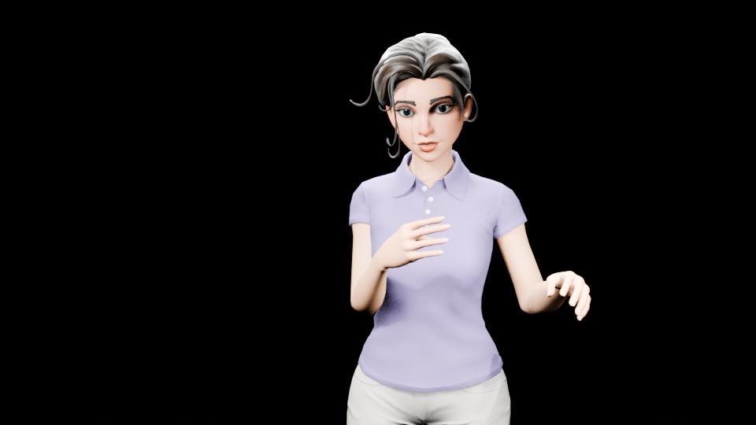
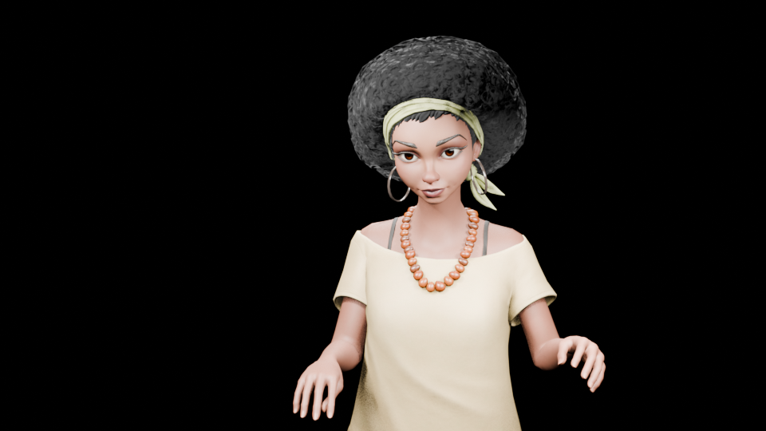

The moving clip is `--shot sign-thank-you-move` → 48 frames at
24fps (`docs/assets/sign-thank-you-move/` keeps start/mid/end;
the full sequence re-renders from the shot). Encode video
locally when needed (no mp4 is committed):

```sh
blender -b --factory-startup --python-exit-code 1 \
  -P scripts/blender/render_host_shots.py -- \
  --out-dir docs/assets --shot sign-thank-you-move
ffmpeg -y -framerate 24 -pattern_type glob \
  -i 'docs/assets/sign-thank-you-move/frame_*.png' \
  -c:v libx264 -pix_fmt yuv420p /tmp/sign-thank-you.mp4
```

The clip keys the citation start arm (f1–12), arcs forward-down
through f36, and holds the palm-down end (f36–48) with a
slight head nod; fingers stay in the citation B handshape
throughout (the Vicars end frame keeps the flat hand).

## Runtime playback — THANK-YOU in the Sumerian Hosts engine

`scripts/blender/export_sign_clip.py` builds the same keyed
movement as a 72-frame armature-only GLB (`.glb` files ship
through the [v0.1-mvp release](https://github.com/bryanchasko/amazon-sumerian-hosts-asl/releases/tag/v0.1-mvp),
not git; one `thank-you` action carrying the rig's bone names)
for the sibling `sumerian-hosts` repo, whose gesture queue
retargets clip GLBs onto the host by bone name
(`mergeAnimationsTo`) and bakes them additive:

```sh
blender -b --factory-startup --python-exit-code 1 \
  -P scripts/blender/export_sign_clip.py -- \
  --sign thank-you --rig fiona --out out/sign-thank-you-fiona.glb
```

Clip layout: f1 rest (additive reference), f12–20 chin hold,
f20–44 forward arc, f44–52 end hold, f52–72 return to rest.
Hosts-repo gesture config on the babylon clock:
`in {1→30}`, `hold {30→50}`, `out {50→180}`. The `thank-you` gesture button appears in the
playground automatically; the showcase rig records the demo
video from there.

## Signing torso — right arm raised, flat hand

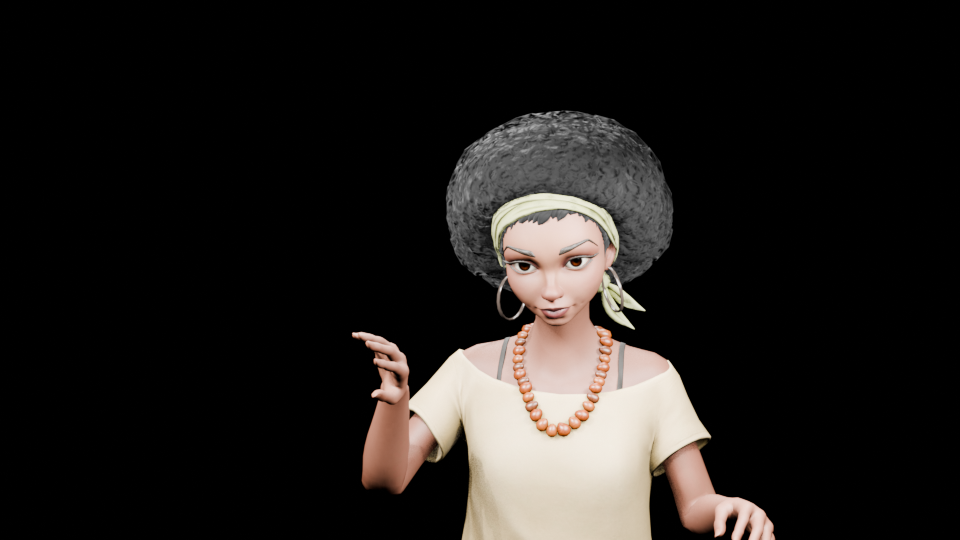

| Bone            | X                 | Y     | Z     |
| --------------- | ----------------- | ----- | ----- |
| Right shoulder  | 0                 | -0.6  | -0.18 |
| Right elbow     | 0                 | -1.45 | 0     |
| Right wrist     | 1.5               | 0     | 0     |
| Left shoulder   | 0                 | -0.18 | -0.30 |
| Left elbow      | 0                 | -1.10 | 0     |
| Neck (head set) | 0.08              | 0     | 0.12  |
| Right hand      | per-shape         |       |       |
| Left hand       | relaxed (staging) |       |       |

```python
SIGNING_TORSO_POSE = [(0.0, -0.6, -0.18), (0, -1.45, 0)]
TORSO_WRIST_ROLL = 1.5
NONDOM_SHOULDER = (0.0, -0.18, -0.30)
NONDOM_ELBOW = (0.0, -1.10, 0.0)
HEAD_NECK = ("char:def_c_neckB", (0.08, 0.0, 0.12))
```

Camera aims between neck and raised wrist, offset
`(0.35, -2.0, 0.45)`, lens 50. The non-dominant (left) arm is
posed, not left at bind: upper arm adducted against the torso,
elbow moderately flexed, relaxed hand resting at the lower
signing space — how the idle arm actually sits while the
dominant hand signs. Shoulder Z takes the same sign on both
sides of this rig (measured; +Z abducts both arms).

Arm staging is scored, not eyeballed:
`scripts/qa/posture_compare.py` measures 280 ASLLRP SignBank
reference frames (real signers) with MediaPipe Pose and scores
these renders against the reference distribution — see
the posture-comparison table in the upstream build repo. The 2026-10-30
fixes (tucked dominant elbow, bent non-dominant elbow, slight
head set, finger cascade in the relaxed hand, asymmetric
ready elbows) all came out of that table.

Pose re-derived 2026-10-29 on true axes (shoulder Y- flexes
forward, elbow Y- flexes): a side view proved every X-twist /
Z-deviation arm value parked the hand BEHIND the body, however
natural the frontal projection looked. The anatomical demo holds
the hand ~17cm forward at chin height in the signing box (elbow
projects 127deg, in the empirical band) with wrist roll 1.5
presenting the palm to camera (neutral wrist faces it down).
Target: forearm/hand in the ASL signing box (chest-to-head
height, within shoulder-width-plus), palm toward front camera,
elbow in natural mid-position.

## Full body — true rest stance

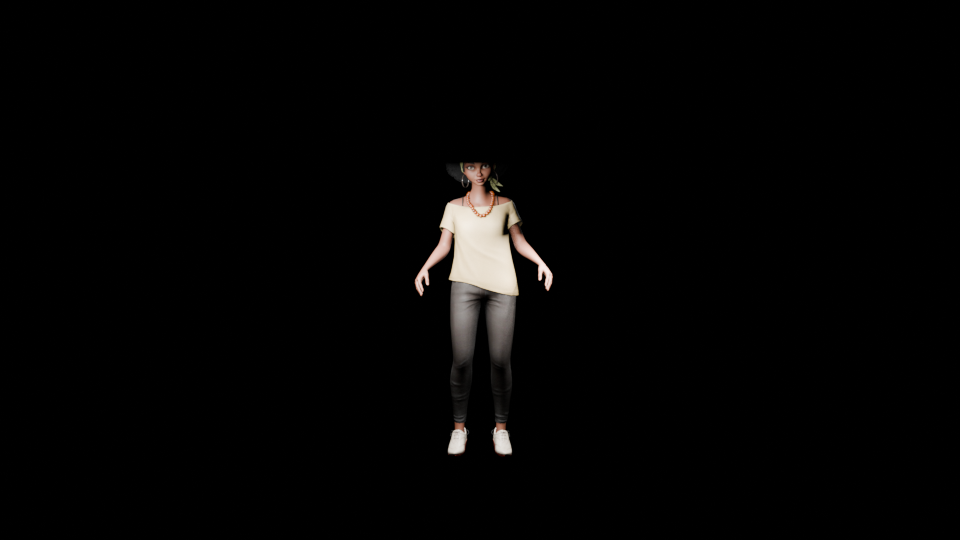

| Bone           | X                 | Y     | Z     |
| -------------- | ----------------- | ----- | ----- |
| Both shoulders | 0                 | -0.08 | -0.35 |
| Both elbows    | 0                 | -0.30 | 0     |
| Both hands     | relaxed (staging) |       |       |
| Both wrists    | straight          |       |       |

```python
shoulder_y, shoulder_z, elbow_flex = (-0.08, -0.35, -0.30)
specs += [("char:def_l_shoulder", (0, shoulder_y, shoulder_z)),
          ("char:def_r_shoulder", (0, shoulder_y, shoulder_z)),
          ("char:def_l_elbow", (0, elbow_flex, 0)),
          ("char:def_r_elbow", (0, elbow_flex, 0))]
```

True rest, re-derived 2026-10-30 from the posture research
(sections 2/4/5): upper arms hang at the sides (measured ~17deg
off vertical, abduction well under 20deg), elbows only slightly
bent, wrists straight, fingers loosely flexed, hands at the
thighs. The bind pose splays the arms ~45deg, so rest needs
shoulder Z −0.35 adduction — same sign both sides (+Z abducts
both arms on this rig; mirroring the sign flung one arm out
sideways, caught on the wide witness). Verified by side view +
joint survey (`scripts/qa/inspect_pose.py`): wrist at thigh
height, slightly forward of the chest plane. This is the
between-signs rest, distinct from the raised ready stance
below.

Camera target `(0, 0, 1.05)`, offset `(0, -5.2, 0.6)`, lens 35 —
head and feet in frame. Tune live with
`FULL_ARM="shy,shz,el"` (true axes).

## Interpreter neutral — hands clasped at the waist

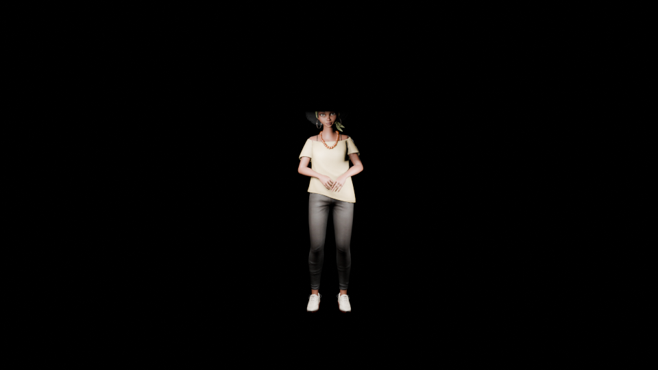

| Bone            | X                 | Y     | Z     |
| --------------- | ----------------- | ----- | ----- |
| Left shoulder   | 1.05              | -0.15 | -0.30 |
| Right shoulder  | 1.15              | -0.15 | -0.30 |
| Left elbow      | 0                 | -0.82 | 0     |
| Right elbow     | 0                 | -0.90 | 0     |
| Neck (head set) | 0.08              | 0     | 0.12  |
| Both thighs     | 0                 | -0.14 | 0     |
| Both hands      | relaxed (staging) |       |       |
| Both wrists     | straight          |       |       |

```python
READY_POSE = {"l_shoulder": (1.05, -0.15, -0.30),
              "r_shoulder": (1.15, -0.15, -0.30),
              "l_elbow": (0.0, -0.82, 0.0),
              "r_elbow": (0.0, -0.90, 0.0),
              "r_wrist": (0.0, 0.0, 0.0)}
STANCE_LEGS = [("char:def_l_thigh", (0.0, -0.14, 0.0)),
               ("char:def_r_thigh", (0.0, -0.14, 0.0))]
```

The between-signs stance a working interpreter actually
holds: hands gently clasped at the waist, upper arms hanging,
elbows soft, feet shoulder-width. An earlier "ready" with both
forearms raised was a frozen guard stance — no interpreter
holds that between signs (reference photos:
reference-images/interpreter/, Wikimedia Commons; the Cologne
standing interpreter idles with one hand loose at her waist,
feet together). Shoulder X twist turns the flexed forearm
medially; measured on the rig, these values land the wrists
meeting at (±0.10m, waist height, ~11cm forward), right hand
a touch higher — a loose clasp, not a mirror pose. STANCE_LEGS
also applies to full-body rest and the transition: the bind
ankles sit ~0.49m apart (A-frame power stance); thigh Y −0.14
brings them to ±0.128m, under the shoulders. MediaPipe Pose
cannot detect the clasped render at all (hands merged at the
waist) — the joint survey is the authority here (comparison
table lives in the upstream build repo).

Camera target `(0, 0, 1.05)`, offset `(0, -5.2, 0.6)`, lens 35.

## Posture transition — rest → neutral → active → neutral → rest

`--shot posture-transition` keys the three stances over 96
frames at 24fps (holds: rest f1–20, ready f38, active f60,
ready f78, rest f96), bezier interpolation throughout. Fingers
are keyed with the arms: relaxed at rest/ready, FLAT on the
active right hand so the active hold matches the signing-torso
still. The neck set drifts a few degrees between holds.

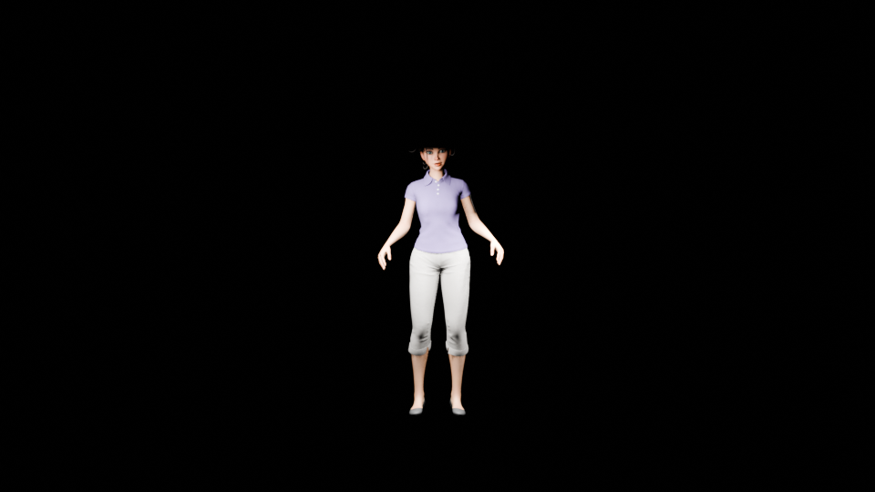
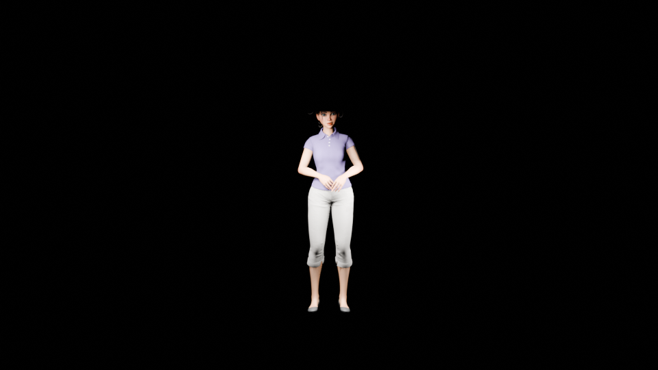
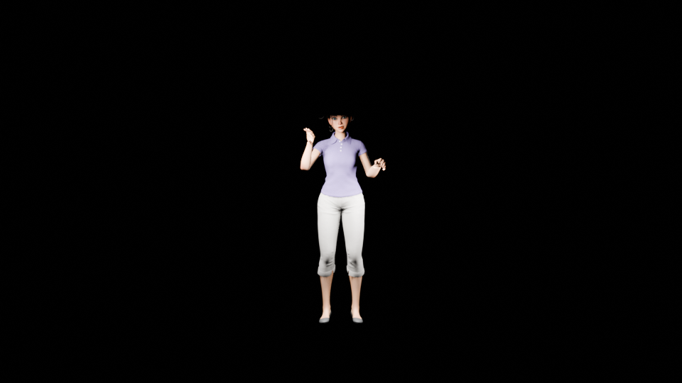
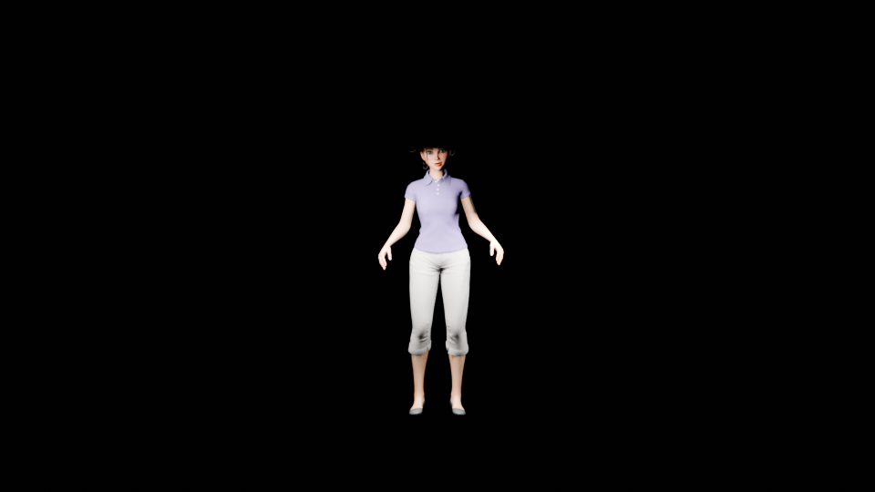
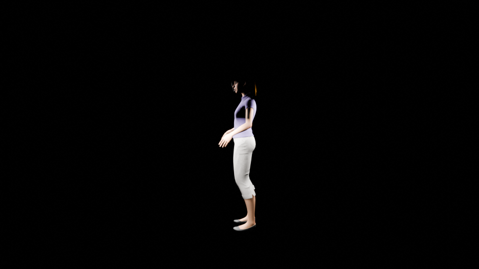
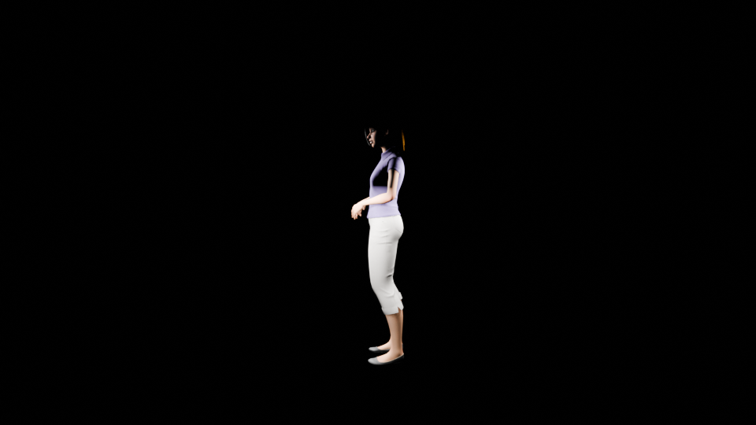
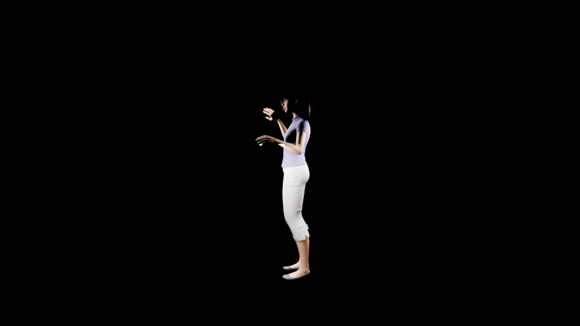

Kept witnesses in `docs/assets/posture-transition/`: front
holds plus side rest/ready/active (full frame sequence is
reproducible from the shot).

Face verdict (2026-10-30): the rig has NO shape keys; the face
is DEF-bone driven. A symmetric bone-location "neutral face"
was tried and reverted — mirrored face bones take local
offsets asymmetrically (brows uneven, mouth pursed at torso
scale). The bind face ships until per-side face calibration
with zoomed close-ups is done. Do not re-apply a symmetric set.

## Sprint 1 — weight shift, clasp hands, joint survey (2026-10-30)

- **Rig joint survey** (`scripts/qa/survey_joints.py`, Blender):
  exports world joint heads + 3D metrics per stance to
  `data/surveys/*.json` — the stance authority where MediaPipe
  is blind (clasped neutral). Note: ankle heads measure
  ±0.119m; the ±0.128m figure is the foot ball.
- **Weight shift** on rest + neutral (keyed in the transition,
  centred at the active hold) so the ankles stay planted:

| Measure               | Value             | Relaxed band | Verdict  |
| --------------------- | ----------------- | ------------ | -------- |
| Pelvis shift          | 16mm              | 10–25mm      | balanced |
| `hip_center_shift`    | 13.7mm            | 10–25mm      | balanced |
| Shoulder height delta | 12.7mm            | 5–15mm       | balanced |
| Spine counter-tilt Z  | 0.032/0.009/0.003 | —            | —        |
| Neck counter total    | −0.044            | —            | —        |
| Thigh swing back      | −0.157/−0.123     | —            | planted  |

- **Hands**: `CLASP_HAND_L/R` alternate A-joint flexion
  (0.35/0.12 vs 0.12/0.35) so fingertips interleave at the
  seam, left thumb more opposed; `RELAXED_HAND_L/R` are
  phase-shifted per hand; FLAT_HAND has a shallow cascade and
  a less hooked thumb. Transition keys now use CLASP at the
  neutral holds.
- **Face calibration**: `--shot face-neutral` (110mm, head
  roll zeroed) + `scripts/qa/measure_brows.py` /
  `sweep_brows.py`. Measured: level-face brow gap 4.9px is
  calibratable to 0.2px (char-L +0.05 / char-R −0.05 local Y),
  but the torso-shot brow gap (7.8px, opposite sign) is
  HEAD_NECK tilt + camera geometry, not brow skin — the
  constant was measured, then REVERTED. Bind face ships;
  do not chase the torso brow gap with brow bones.

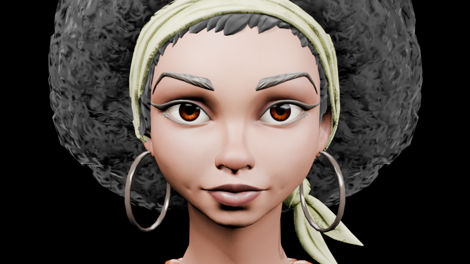

## Reproducing any pose

```sh
blender -b --factory-startup --python-exit-code 1 \
  -P scripts/blender/render_host_shots.py -- \
  --out-dir docs/assets --shot full-body,signing-neutral,signing-torso
blender -b --factory-startup --python-exit-code 1 \
  -P scripts/blender/render_host_shots.py -- \
  --out-dir docs/assets \
  --shot number-2,number-3,number-4,number-2-prof,number-3-prof,number-4-prof
blender -b --factory-startup --python-exit-code 1 \
  -P scripts/blender/render_host_shots.py -- \
  --out-dir docs/assets \
  --shot torso-a,torso-b,torso-f,torso-n1,torso-n5,torso-n2,torso-n3,torso-n4
```

Handshape A/B/F/1/5 stills render from
`scripts/spike-finger-articulation/pose_handshapes.py`
(fronts and profiles render together):

```sh
blender -b --factory-startup --python-exit-code 1 \
  -P scripts/spike-finger-articulation/pose_handshapes.py -- \
  --out-dir docs/assets --shapes a,b,f,n1,n5
```

Chereme preset: numbers default `cardinal_numeral` (palm-in,
dorsal to the addressee), letters default `letter_or_digit`
(palm-out). Override per render with `--chereme` (or
`CHEREME` env) — e.g. `--chereme letter_or_digit` on a number
shot renders the palm-out digit-string inflection. Trial
overrides `IDLE_SH` / `IDLE_EL` / `WRIST_ROLL` / `WRIST_FLEX` /
`WRIST_DEV` / `PALM_DIST` envs beat the preset for one render;
baked pixels always come from preset defaults with a clean env.
